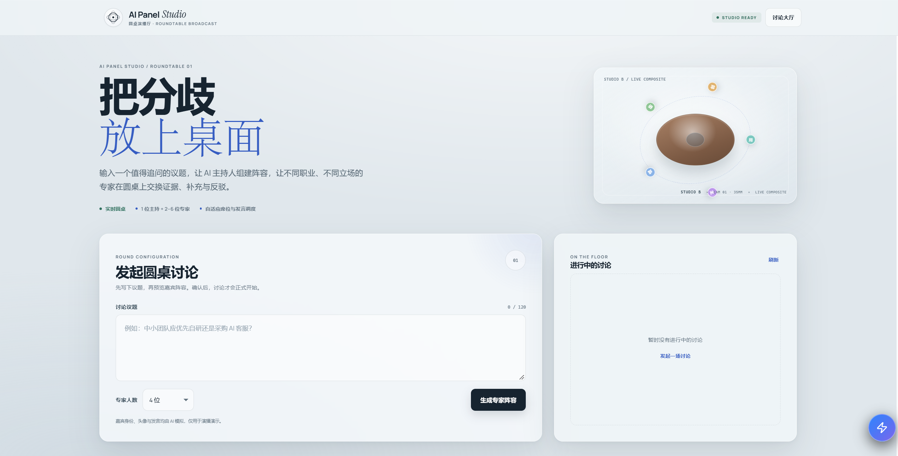
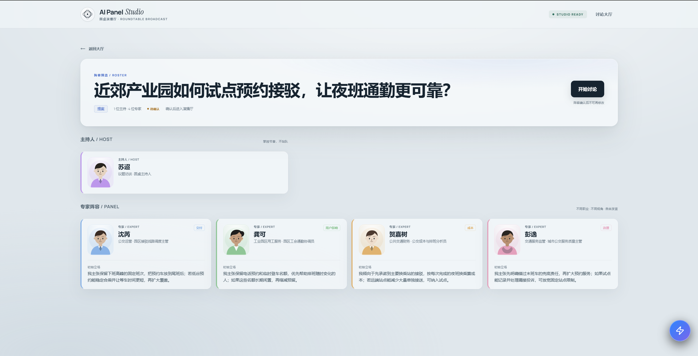
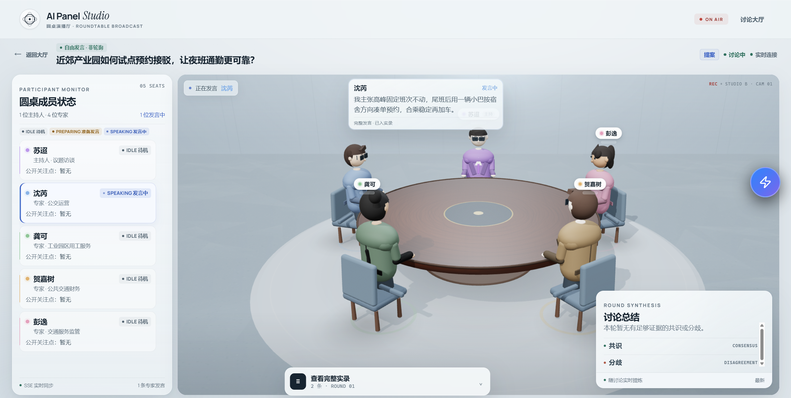
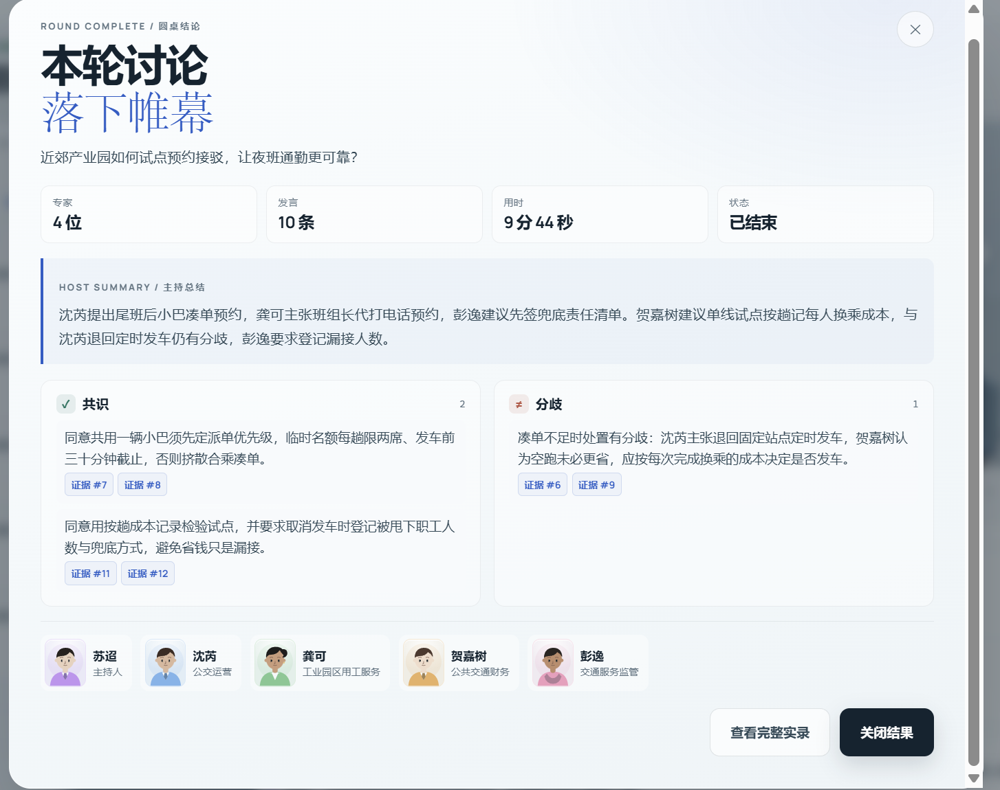
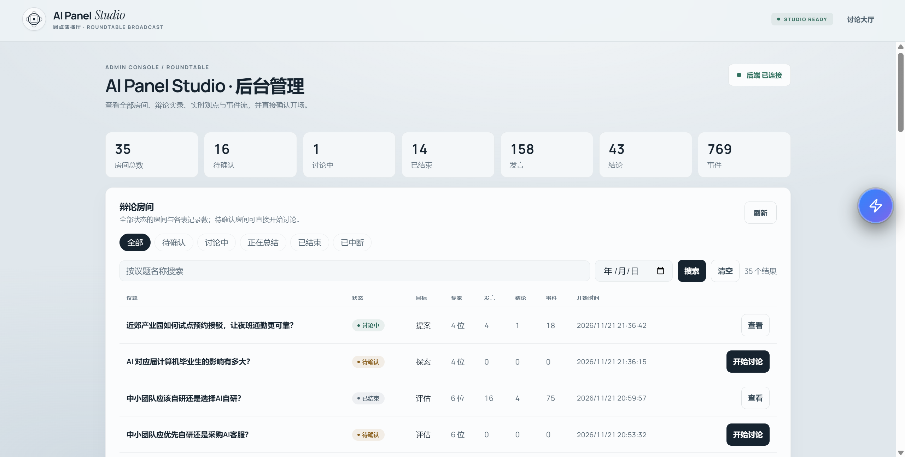
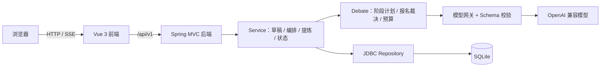

# AI Panel Studio · AI 圆桌演播厅

一个可本地运行的中文 Web 应用：用户给定议题，系统生成一位主持与多位专家，在演播厅里实时辩论，边讨论边提炼共识与分歧，最后给出可追溯的总结。支持同时运行、旁观多场讨论。

- 前端：Vue 3 + TypeScript + Vite + Three.js，原生 `EventSource` 消费 SSE
- 后端：Java 21 + Spring Boot 3.5.16 + Spring MVC + Spring JDBC + SQLite
- 模型：OpenAI 兼容 Chat Completions 协议；未配置模型时可用确定性脚本离线演示
- 交付边界：单实例、本地运行；前端由 Vite 提供，后端可打包为一个可执行 jar

> 本 README 汇总了前后端说明与整体运行方式。更细的契约见 [PRD](./docs/PRD.md)、[API 文档](./docs/api.md)、[数据模型](./docs/schema.md)、[架构说明](./docs/architecture.md)、[测试文档](./docs/testing.md)。

**页面预览：**

首页：
角色生成页面：
演播厅讨论页面：
讨论结果页面：
后台管理页面：


## 1. 功能一览

| 模块 | 已实现能力 |
| --- | --- |
| 大厅 | 输入议题、选择专家人数（默认 4）、从预设议题创建草稿、旁观进行中房间；桌面与窄屏均可独立滚动 |
| 阵容 | 预览主持与专家的身份、职业、Title、色标、立场与视角；主持立场固定为空；确认后才启动，重复确认只启动一次 |
| 演播厅 | 真实事件驱动的待机 / 准备 / 发言状态；自由发言而非按座位轮询；专家可连续接话、被主持串联；公开关注点只来自受控类别 |
| 实时结论 | 每条专家发言后增量提炼；结论引用本场两位以上专家原文；证据不足时保留上一版并标记 `STALE` |
| 收尾 | 主持总结只归纳可追溯观点、已明确共识与未决分歧，入库后才置为 `COMPLETED`；失败后仍可回看已公开实录 |
| 断线恢复 | SSE 按游标回放历史事件；缺号、跨房间、非法状态跳转均触发快照恢复；终态追平后连接关闭 |
| 管理台 | `/admin` 查看状态计数、记录量、房间明细、完整事件流，支持按状态、关键词、日期检索 |
| 质量保障 | 阵容、调度、提炼按 TDD 覆盖；后端集成测试使用临时 SQLite；系统级 Playwright 覆盖真实前后端链路与三档视口 |

## 2. 技术选型

| 层次 | 选型与版本 | 选择理由 |
| --- | --- | --- |
| 前端框架 | Vue 3.5.46、Vue Router 4.6.5、TypeScript 5.9.3 | Composition API + `<script setup>` 让会话状态与事件处理集中、可测试 |
| 构建与开发 | Vite 7.3.8、Node.js ^20.19 或 ≥22.12 | 冷启动快，代理配置简单，构建产物可独立静态托管 |
| 实时通道 | 浏览器原生 `EventSource` | 天然支持 `Last-Event-ID`，相比 WebSocket 更适合服务端单向广播与游标回放 |
| 视觉表现 | Three.js 0.187.0 | 圆桌场景、坐姿与视线需要真实 3D；无 WebGL 环境自动降级为平面模式 |
| 后端框架 | Spring Boot 3.5.16、Spring MVC、Java 21 | 成熟的同步 Web 栈，线程池、事务与配置绑定能力完整，便于表达阶段编排 |
| 数据访问 | Spring JDBC + SQLite 3.45.3.0 | 单文件零依赖；参数化 SQL 明确；WAL 下读快照与短写事务可并发 |
| 契约校验 | NetworkNT JSON Schema Validator 2.0.0 | 模型输出按运行时 Schema 校验，叠加业务校验后再入库 |
| 前端测试 | Vitest 3.2.7、@vue/test-utils 2.4.6、Playwright 1.65.1 | 组件级快速反馈 + 浏览器级真实链路验证 |
| 后端测试 | JUnit 5、MockMvc、AssertJ、临时 SQLite | 不依赖外部数据库；模型网关用替身，测试可重复 |

## 3. 架构总览



- 模型调用位于事务之外；写回时用预期状态与内容版本校验，迟到结果直接丢弃。
- 发言顺序、引用归属、结论证据与事件序号全部由服务端决定，模型只提供候选内容。
- 事件与业务数据在同一事务提交；SSE 先按游标回放已提交事件，再持续推送。

完整时序、并发预算与安全边界见 [架构说明](./docs/architecture.md)。

## 4. 目录结构

```text
RoundtableDiscussion/
├── frontend/                  Vue 3 前端（src、tests、playwright 配置）
├── backend/                   Spring Boot 后端（src/main、src/test、pom.xml）
├── prompts/                   R01–R08 运行时 System Prompt 与流程模板
├── docs/                      PRD、数据模型、API、架构、测试、E2E 用例、交付记录
├── init.sql                   SQLite DDL 与内置预设（唯一初始化脚本）
├── AGENTS.md                  项目协作与规格约束
├── README.md                  本文件
├── backend/README.md          后端专项说明
└── frontend/README.md         前端专项说明
```

## 5. 快速开始

### 5.1 环境要求

| 依赖 | 版本 |
| --- | --- |
| JDK | 21 |
| Maven | 3.9+ |
| Node.js | ^20.19 或 ≥22.12 |
| npm | 随 Node 提供 |

首次运行需要联网安装 npm 依赖与 Maven 依赖；构建完成后可离线运行。

### 5.2 方式一：离线演示（不调用外部模型）

```powershell
# 1. 安装前端依赖并构建后端可执行包
npm --prefix frontend install
mvn -B -f backend/pom.xml package -DskipTests

# 2. 终端 A：以确定性脚本模式启动后端（http://127.0.0.1:8080）
java -jar backend/target/ai-panel-backend-exec.jar `
  --spring.profiles.active=dev `
  --panel.gateway.mode=scripted `
  --panel.db.path=backend/target/dev-db/panel.db `
  --panel.db.allowed-root=backend/target/dev-db

# 3. 终端 B：启动前端，浏览器访问 http://127.0.0.1:5173
npm --prefix frontend run dev
```

脚本模式用固定样例模拟主持与专家，适合评审演示与端到端联调；界面、事件与结论流程与真实模型一致。

### 5.3 方式二：接入真实模型

```powershell
$env:PANEL_AI_BASE_URL = "https://your-provider.example.com/v1"
$env:PANEL_AI_MODEL = "your-model-id"
$env:PANEL_AI_API_KEY = "sk-..."
$env:PANEL_AI_CONTEXT_WINDOW = "32768"

# 终端 A：后端（不传 --panel.gateway.mode=scripted 即走真实网关）
java -jar backend/target/ai-panel-backend-exec.jar

# 终端 B：前端
npm --prefix frontend run dev
```

- 密钥只由后端进程读取，前端 bundle 与接口响应均不包含密钥。
- 供应商需支持 Chat Completions 的 JSON 对象输出。
- 配置缺失时创建讨论返回 `503/B4001`，不会静默降级到假数据。
- 可用 `PANEL_AI_EVIDENCE_ENABLED=false` 关闭专家查证。

### 5.4 前后端分开开发

```powershell
# 终端 A：后端
mvn -B -f backend/pom.xml spring-boot:run -Dspring-boot.run.profiles=dev

# 终端 B：前端，访问 http://127.0.0.1:5173
npm --prefix frontend run dev
```

Vite 默认把 `/api/v1` 代理到 `http://127.0.0.1:8080`；后端使用其他端口时设置 `PANEL_BACKEND_URL`。

### 5.5 数据库

- 默认业务库为 `data/panel.db`，首次启动自动执行根目录 `init.sql`。
- 打开连接前校验路径必须位于 `panel.db.allowed-root` 内，拒绝符号链接逃逸。
- 每个连接强制 `foreign_keys=ON`、`journal_mode=WAL`、`busy_timeout=5000`。
- 重置数据：停止服务后删除 `data/panel.db*`，下次启动重新初始化。

## 6. 环境变量与配置

| 配置项 | 默认值 | 说明 |
| --- | --- | --- |
| `panel.db.path` | `data/panel.db` | SQLite 文件路径，相对路径按进程工作目录解析 |
| `panel.db.allowed-root` | `data` | 允许打开数据库的目录，越界直接拒绝 |
| `panel.db.init-script` | `classpath:db/init.sql` | 初始化脚本，构建时从根目录 `init.sql` 拷入 |
| `panel.db.initialize` | `true` | 启动时是否执行初始化 |
| `PANEL_AI_BASE_URL` | 空 | 供应商 API 基地址，可含 `/v1`；网关追加 `/chat/completions` |
| `PANEL_AI_MODEL` | 空 | 模型标识 |
| `PANEL_AI_API_KEY` | 空 | 模型凭据，仅后端读取 |
| `PANEL_AI_TEMPLATE_DIRECTORY` | 包内 `prompts/` | 自定义 Prompt 模板目录（UTF-8） |
| `PANEL_AI_TEMPLATE_VERSION` | `v2.8` | 模板版本号，修改模板时同步更新 |
| `PANEL_AI_CONTEXT_WINDOW` | `32768` | 模型上下文窗口，用于裁剪与调用预算 |
| `PANEL_AI_EVIDENCE_ENABLED` | `true` | 是否允许专家待机时查证复杂事实或前沿研究 |
| `PANEL_AI_REASONING_EFFORT` | `low` | 思考强度；圆桌用快速思考，可选 `minimal`/`medium`/`high`，`off` 不发送该字段 |
| `PANEL_AI_EVIDENCE_TIMEOUT_MILLIS` | `12000` | 后台查证总时限，含排队。0 表示关闭；兼容旧环境变量 PANEL_AI_EVIDENCE_WAIT_MILLIS |
| `PANEL_AI_TIMEOUT_ROSTER` | `50` | 阵容生成（R01）单次超时，秒 |
| `PANEL_AI_TIMEOUT_UTTERANCE` | `35` | 报名与短发言（R02/R03/R05/R06）单次超时，秒 |
| `PANEL_AI_TIMEOUT_INSIGHT` | `45` | 实时提炼（R04）单次超时，秒 |
| `PANEL_AI_TIMEOUT_SUMMARY` | `30` | 主持收尾（R07）单次超时，秒 |
| `PANEL_AI_TIMEOUT_DISCUSSION` | `600` | 单场讨论总预算，秒 |
| `PANEL_AI_MODE`（dev） | `auto` | 配齐模型参数时走真实网关；`scripted` 强制离线样例 |
| `panel.gateway.mode` | `real` | 根配置的网关模式，可显式设为 `scripted` |
| `panel.orchestration.capacity` | `2` | 同时执行的讨论数，与讨论线程池大小一致 |
| `panel.orchestration.max-expert-utterances` | `0` | `0` 表示按进展收尾；正数表示专家发言总数上限 |
| `panel.orchestration.stage-delay-millis` | `0` | 相邻阶段间隔，便于观察状态变化 |
| `panel.request.allowed-hosts` | `127.0.0.1,localhost,::1` | 回环 Host 白名单，越界返回 403 |
| `panel.request.allowed-origin-ports` | `5173,5183,8080` | 写请求 Origin 允许的本地端口 |
| `PANEL_BACKEND_URL`（前端） | `http://127.0.0.1:8080` | Vite 代理目标 |

服务默认监听 `127.0.0.1:8080`，日志写入 `logs/panel.log`。

## 7. 主要 API

统一响应体 `{code, message, data, timestamp}`；分页、字段与错误码详见 [API 文档](./docs/api.md)。

| 方法 | 路径 | 成功 | 说明 |
| --- | --- | --- | --- |
| `GET` | `/api/v1/discussions?status=ACTIVE` | `200` | 大厅可见的运行中 / 总结中房间 |
| `POST` | `/api/v1/discussions` | `201` + `Location` | 生成阵容并返回 `DRAFT` 快照 |
| `GET` | `/api/v1/discussions/{id}` | `200` | 房间快照（成员、实录、结论、`lastEventSeq`） |
| `DELETE` | `/api/v1/discussions/{id}` | `204` | 删除已中断房间及其记录 |
| `POST` | `/api/v1/discussions/{id}/start` | `202` | 确认开场；重复确认幂等，容量满 `429` |
| `GET` | `/api/v1/discussions/{id}/events?after=` | `200` `text/event-stream` | 先回放后实时；终态追平返回 `204` |
| `GET` | `/api/v1/presets` | `200` | 六条内置预设，按 slug 升序 |
| `POST` | `/api/v1/presets/{slug}/discussions` | `201` | 复制预设为独立草稿，不调用模型 |
| `GET` | `/api/v1/admin/overview` | `200` | 状态计数与记录量 |
| `GET` | `/api/v1/admin/discussions?status=&keyword=&date=` | `200` | 房间列表与检索 |
| `GET` | `/api/v1/admin/discussions/{id}` | `200` | 房间快照 + 完整事件流 |

### SSE 事件

| 事件 | 触发时机 | 主要载荷 |
| --- | --- | --- |
| `discussion.status` | 开场、进入总结、完成、失败 | `discussionId`、`status` |
| `participant.status` | 专家待机 / 准备 / 发言、主持介入 | 成员 ID、`stageStatus`、`publicFocus` |
| `utterance.added` | 主持开场、专家发言、主持总结 | 序号、成员、`kind`、正文 |
| `insight.updated` | 每次提炼成功或标记 `STALE` | 结论、证据、`insightStatus`、来源游标 |

事件信封带 `seq`；`Last-Event-ID` 优先于 `after`。公开 DTO 不含报名候选、调度分数与模型原始响应。

## 8. 内置预设

`init.sql` 提供六条预设，每条含一位主持与四位专家、明确讨论目标与完整阵容：

| slug | 议题 | 目标 |
| --- | --- | --- |
| `ai-graduate-careers` | AI 对应届计算机毕业生的影响有多大？ | EXPLORE |
| `bus-demand-shuttle` | 近郊产业园如何试点预约接驳，让夜班通勤更可靠？ | PROPOSE |
| `clinic-message-reminders` | 社区诊所应把复诊提醒默认改为微信消息吗？ | EVALUATE |
| `grocery-pickup-delays` | 生鲜门店上线自提预约后，晚高峰等待为何反而变长？ | SOLVE |
| `office-retrofit-heat` | 老旧办公楼降温，应优先换空调还是先做外遮阳？ | EVALUATE |
| `rental-repair-disputes` | 租赁社区如何改进报修流程，减少超时和押金纠纷？ | PROPOSE |

## 9. 测试与验证

```powershell
# 后端：单元 + 集成（临时 SQLite，模型网关替身）
mvn -B -f backend/pom.xml test

# 前端：类型检查与组件测试
npm --prefix frontend run typecheck
npm --prefix frontend test

# 浏览器级流程（需先安装 Playwright 浏览器）
npm --prefix frontend exec playwright install chromium
npm --prefix frontend run test:browser

# 系统级 E2E（需先打包 jar，服务与假上游由用例托管）
mvn -B -f backend/pom.xml package -DskipTests
npm --prefix frontend run test:system
```

测试分层、覆盖矩阵、TDD 记录与最近一次实测结果见 [测试文档](./docs/testing.md)；系统级用例明细见 [E2E 测试用例](./docs/e2e-test-cases.md)。

## 10. 已完成能力

- [x] 大厅、阵容预览、演播厅、后台管理台四个页面与路由
- [x] 主持 1 位 + 专家 N 位（默认 4）的阵容生成、校验与预览
- [x] 预设议题复制为独立草稿，重复复制互不影响且不调用模型
- [x] 确认开场的状态机、幂等确认、容量限制与失败回滚
- [x] 阶段化讨论：开场、报名、裁决、发言、追问 / 串联、总结
- [x] 服务端发言调度：意图权重、阶段关注点、缺席时长、连续发言让位、允许 `PASS`
- [x] 实时提炼结论：引用本场两位以上专家原文，证据不足保留旧版并标记 `STALE`
- [x] 主持收尾只归纳可追溯内容，总结与 `COMPLETED` 同事务提交
- [x] SSE 快照 + 游标回放、断线重连、缺号恢复、跨房间与迟到事件过滤
- [x] 运行预算：讨论容量、模型 I/O 并发、调用总量、单场时长、SSE 连接配额
- [x] SQLite 路径守卫、连接级外键与 WAL、幂等初始化与六条预设
- [x] 回环 Host / Origin 校验、参数化 SQL、纯文本渲染、密钥隔离
- [x] 模型输出 JSON Schema + 业务校验，隐藏推理字段丢弃
- [x] 后台管理：状态统计、房间检索、快照与事件流排障
- [x] 三档视口（1920×1080、1366×768、390×844）响应式与键盘可用性
- [x] 单元、集成、组件、浏览器与系统级五层测试

## 11. 后续改进方向

当前版本刻意限定为本地单实例、无登录。若要供多人长期使用，下一阶段优先引入用户体系：

1. **账号与身份**：注册 / 登录、密码哈希（BCrypt / Argon2）、会话或 JWT、找回密码与注销。
2. **数据归属与权限**：房间、预设、结论归属到用户或团队；区分房主、参与者、旁观者、管理员；所有接口按房间校验访问权，避免水平越权。
3. **实时通道鉴权**：SSE 连接携带短期令牌，重连与回放同样校验房间权限；断开登录后立即失效。
4. **多租户与配额**：按用户 / 组织隔离数据与模型额度，限制并发讨论数、调用量与 Token 预算，防止单用户占满资源。
5. **协作能力**：邀请链接、多人旁观、观众提问、共享结论卡片；操作审计与可见范围控制。
6. **部署形态**：由 SQLite 单文件迁移到服务型数据库（PostgreSQL），讨论执行改为可横向扩展的任务队列，会话与连接状态外置；补齐反向代理、HTTPS 与灰度发布。
7. **可观测性**：接入结构化日志与指标（QPS、SSE 连接数、模型延迟、失败率、Token 消耗），配置告警与追踪 ID 串联。
8. **体验与质量**：移动端交互细化、无障碍审计、模型质量回归集扩充与真实模型耗时基线。

## 12. 文档索引

| 文档 | 内容 |
| --- | --- |
| [PRD](./docs/PRD.md) | 需求、验收标准、状态机与非目标 |
| [数据模型与状态机](./docs/schema.md) | ER 图、字段字典、约束与原子写入 |
| [API 文档](./docs/api.md) | 接口、错误码、SSE 契约与示例 |
| [架构说明](./docs/architecture.md) | 分层、时序、并发预算、安全与取舍 |
| [测试文档](./docs/testing.md) | 测试策略、矩阵、命令与实测记录 |
| [E2E 测试用例](./docs/e2e-test-cases.md) | 系统级验收场景与证据 |
| [运行时 Prompt 规格](./prompts/README.md) | R01–R08 模板、装配顺序与失败策略 |
| [分阶段开发 Prompt](./docs/AI圆桌演播厅-分阶段Prompt.md) | SDD / DDD / TDD / E2E 任务记录 |
| [交付与工作流](./docs/AI圆桌演播厅-交付与工作流.md) | Git 演进、Prompt 归档与提交包 |
| [后端说明](./backend/README.md) | 后端运行、配置与内部结构 |
| [前端说明](./frontend/README.md) | 前端页面、目录与交互约束 |

注：未经作者许可不得转载、复用、二次分发。