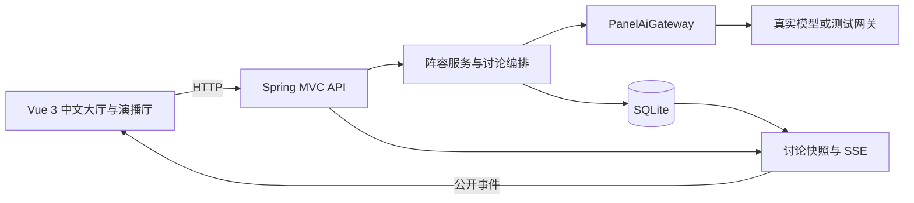
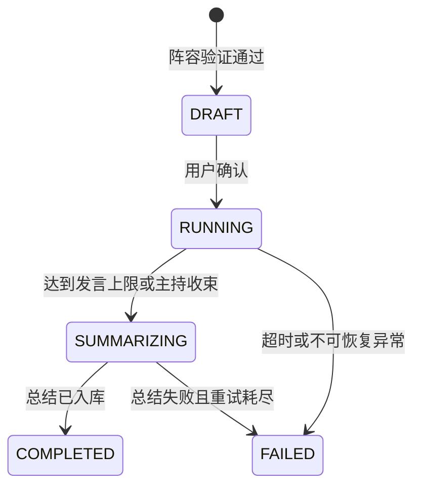
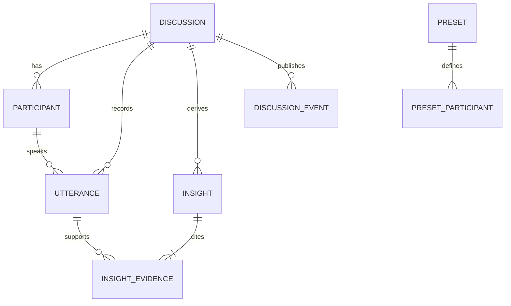
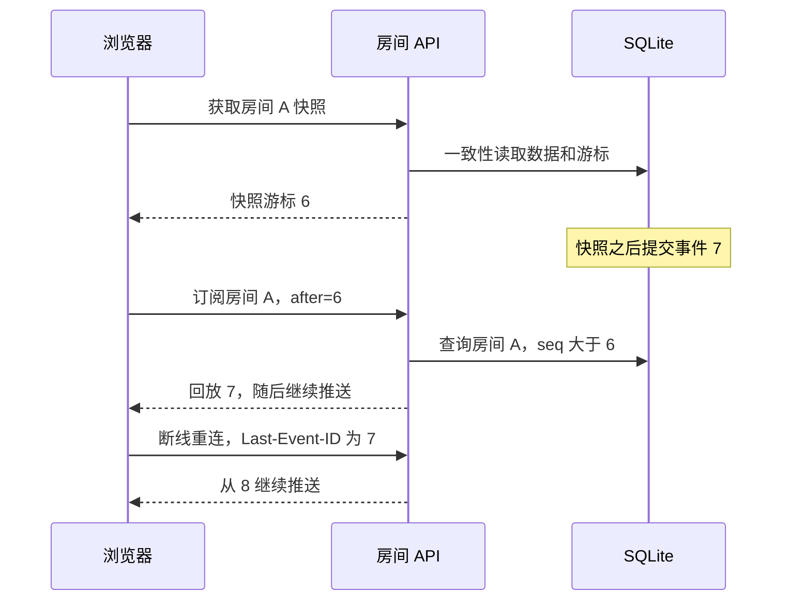
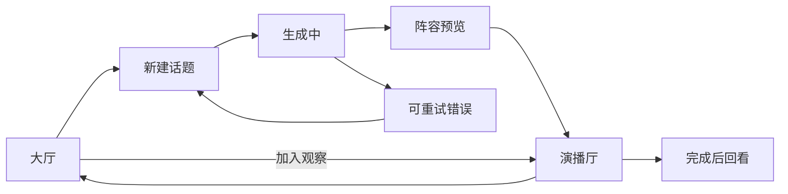

# AI Panel Studio 产品与工程设计

面向独立开发者和作业评审。本文给出需求基线、产品决策、接口与数据草案、前端验收和测试设计。工作区目前只有作业说明与协作规范，以下内容是拟实施规格，技术版本与运行效果待开发验证。

- [作业原文](../AI开发实习生远程作业-AI圆桌讨论WebAppMVP.md)
- [分阶段开发 Prompt](./AI圆桌演播厅-分阶段Prompt.md)
- [运行时 Prompt](../prompts/README.md)
- [交付与工作流](./AI圆桌演播厅-交付与工作流.md)

正文依次覆盖产品与验收、SDD 数据和接口、DDD 演播厅设计、TDD 核心逻辑、E2E 系统验收。

## 1. 产品定位与目标用户

AI Panel Studio 是一款本地中文 Web 应用。用户提出一个问题，确认主持人与专家阵容后，旁观一场自动推进的模拟圆桌。首页回答「哪些议题正在讨论」。演播厅回答「现在是谁在回应谁」「观点在哪里达成一致或产生分歧」。用户结束观看后能阅读主持人的自然语言总结。

| 用户 | 使用情境 | 主要痛点 | 对应产品设计 | 验收信号 |
| --- | --- | --- | --- | --- |
| 产品与决策人员，主验收用户 | 评审前预演方案，例如「平台应优先自研还是采购」 | 单次 AI 问答容易顺着提问者的假设，忽略成本、风险与反例 | 阵容预览暴露不同职能与初始立场，主持人追问关键假设，专家引用具体发言反驳 | 能指出已达成的一项共识、仍有争议的一项取舍及相关发言 |
| 知识工作者与研究人员 | 用有限时间探索陌生问题或并行调查多个方向 | 多个独立对话割裂，议题之间容易串线 | 同一讨论共享公开实录，各讨论独立运行，首页能进入任意进行中房间 | A、B 讨论同时产生更新，切换与重连后仍各自显示正确内容 |
| 教育与内容创作者 | 给复杂议题编排可观看的多角色讨论 | 只看最终答案，缺少角色、节奏和观点变化 | 主持控场、专家席状态、发言实录与实时结论；完成后的同一链接可阅读实录 | 第一次旁观能识别当前发言人及发言进度，结束后能查阅完整实录与总结 |

用户在阵容确认前能检查视角覆盖和立场差异。进入演播厅后主要操作是切换观察区域、回看上文和返回大厅。讨论在后台推进，观众离开房间或刷新浏览器时继续。专家使用虚构身份，发言与总结属于 AI 模拟内容，UI 显示一次简明标识。产品愿景中的录制和可回放对应后续能力，本期交付完成后查阅实录与总结。

### 痛点、处理机制与验收

| 痛点 | 发生场景与用户损失 | 产品与工程方案 | Prompt 的具体职责 | 可证伪的验收 |
| --- | --- | --- | --- | --- |
| U01 视角单一 | 产品经理问「买还是自研」，多个 AI 角色同时给出「先试点」，评审仍看不到在交付速度、数据控制之间该怎么取舍 | 阵容预览显示职能、分析视角与可被质疑的初始立场。Spring 校验阵容数量、视角唯一和字段边界。主持在开场明确讨论范围，向各方追问条件及证据来源 | R01 让专家从不同决策维度明确表达偏好、成立条件。R05 邀请各方专家提出评估取舍及依据。R06 定向追问缺失视角或未验证条件 | T01 拒绝换名但重复视角类别的阵容。Q01 人工比较跨主题样例的立场是否真实不同。E01 在确认前可查看与比较阵容 |
| U02 异步割裂 | 研究者先收到采购建议，另一专家的架构建议却没回应采购成本。用户必须手工拼接多段对话 | 在一个版本的已提交实录上分别询问每位专家。调度器依据有效报名选发言人。补充与反驳绑定目标发言号，界面可跳回原发言 | R02 单独问一位专家「是否有新的贡献」，允许 `PASS`。R03 回应目标发言的具体主张。R06 引用实录将前后观点串联 | T02 给定同一上下文可观察 A、A、C 的顺序。T03 拒绝伪造或跨场引用。E01 从公开发言跳回原发言。Q02 判断回应是否针对原主张 |
| U03 过程不可见 | 长时间等待后只看到总结，用户无法判断谁正在发言、观点何时改变或凭什么成立 | 后端发布真实阶段事件、公开关注点和已入库发言。每条专家发言之后尝试刷新有证据的结论，提炼暂时失败时保留上次结果并提示更新暂缓 | R02 仅产生可映射的关注类别。R03 只提供公开口播。R04 输出共识/分歧及证据原话。R07 根据已知证据输出主持总结 | T04 拦截伪造引用，保留上次有效观点。E03 在房间仍运行时看到专家状态、结论和证据，之后看到自然语言总结。Q03 检查引用是否支持结论 |
| U04 议题管理混乱 | 同时比较两个顾客方案，重连或切换房间后混入上一场消息，证据和结论失去可信度 | 以房间 ID 为写入、快照和订阅边界。Vue 会话随路由重建，SQLite 复合约束与 SSE 游标保障隔离。大厅入口与重连为确定性逻辑 | F01、N02 由应用协议实现。R01–R07 的每次模型输入仅由当前房间构建，模型无法选择房间、订阅或写入范围 | T06 校验跨房间写入和事件回放。E02 两个观察客户端收到各自唯一标记。E04 断线后补齐事件并保持顺序 |

### 功能范围与验收基线

| 编号 | 作业要求 | 可验收行为 |
| --- | --- | --- |
| F01 | 首页展示正在进行的讨论，可旁观或发起 | 大厅列出 `RUNNING` / `SUMMARIZING` 房间，点击进入同一讨论。空列表显示新建入口。运行中可返回大厅发起第二场。 |
| F02 | 动态生成与确认阵容 | 非空话题输入，专家人数默认 4。模型识别评估、提案、排查或探索，生成 1 位主持人与 N 位来自不同方向、部门或领域的专家。预览讨论类型、姓名、职业、Title、唯一颜色和专家立场。主持的立场与视角均为 `null`。选择「开始讨论」后才启动任务。 |
| F03 | 主持控场、专家自主发言 | 主持界定范围、串联阶段、厘清分歧、邀请多方举证及溯源，并中立归纳专家发言。业务观点、立场、假设和判断由专家席位提出。服务按固定讨论目标选择阶段，每个报名窗口冻结本场上下文。专家独立报名，服务端结合当前阶段及有效候选决定发言者，公开发言为 1–2 句。 |
| F04 | 专家状态、公开关注点 | 专家席能区分待机、准备发言、发言中。关注点只取约定的公开字段，通过文本和样式标明状态；发言气泡仍在演播厅展示期间，对应席位保持发言中，与气泡状态同步。 |
| F05 | 实时共识与分歧 | 有足够依据的验收场景必须在总结之前看到结论更新。每条观点带本场证据。证据不足显示空态，提炼失败显示「观点更新暂缓」并保留上次有效结果。 |
| F06 | 现场 Transcript（发言实录） | 按顺序展示说话者姓名、职业、Title、对应色块及正文。报名意图、评分和模型结构化原文属于服务端数据。 |
| F07 | 主持总结 | 讨论结束时可读取两句中立收尾。主持按归属归纳专家观点、共识范围、分歧及证据缺口。 |
| N01 | 前后端分离、SQLite、密钥后端化 | 独立启动前端和后端，空数据库可迁移与加载预设。浏览器只访问应用 API，构建目录和可见响应均无上游密钥。 |
| N02 | 并行隔离与实时传输 | 同时运行两场讨论。各自产生的成员、增量事件、发言和发现严格归属于本场。刷新、断线、重新连接后内容有序。 |
| N03 | 中文响应式、区域独立滚动 | 1920×1080、1366×768、390×844 检查页面。桌面各主要内容区独立滚动，窄屏用视图切换获取对应内容，页面根容器保持视口高度。 |

### 功能到运行时 Prompt 的实现契约

| 功能 | 触发与输入 | Prompt 及模型输出 | Spring 约束与 Vue 呈现 | 验收 |
| --- | --- | --- | --- | --- |
| F01 首页、创建入口、旁观 | 页面进入或恢复焦点刷新 `ACTIVE` 列表，选择现有房间或预设 | 无模型调用 | 首页用查询状态渲染空态、进行中、错误重试。旁观只读取现有房间，预设复制成新草稿 | E02、E07 |
| F02 阵容与确认 | 创建时输入规范化主题、专家人数和可用视角枚举 | R01 一次返回目标类型、嘉宾身份和专家视角及立场。主持立场和视角均为 `null` | 校验目标和阵容后原子保存。确认前显示类型、名单与立场，确认后启动任务。生成失败保留输入 | T01、E01、Q01 |
| F03 开场、发言、追问及串联 | 确认后开场。服务端按类型与阶段配置推进。每个报名窗口冻结本场上下文 | R05 开场，R02 独立报名，R03 发言，R06 追问或串联。各任务读取类型和当前阶段 | Spring 冻结阶段表、限制轮数和时间、校验并裁决候选。Vue 舞台按公开事件展示当前说话者 | T02、T03、E01、Q02 |
| F04 专家状态小窗 | 从候选被选中到公开发言生成和提交 | R02 产生受限 `focusCode`；应用发布状态 | Spring 映射公开关注标签，按真实执行状态发布 `PREPARING / SPEAKING / IDLE`。Vue 小窗用文字与样式体现状态 | T03、E03 |
| F05 实时共识与分歧 | 每条专家发言入库后请求提炼，输入本场已提交发言及上版有效观点 | R04 返回分类、观点与原文证据 | Spring 校验发言和确切引文，提交投影与事件。Vue 分区显示观点，可跳转证据发言；暂缓时显示上版证据 | T04、E03、Q03 |
| F06 现场实录 | 消费 `utterance.added` 或重建快照 | 正文来自 R03、R05、R06、R07；实录展示无需另一次模型调用 | Spring 公开说话者、正文和可选回应目标。Vue 用成员色标、姓名、职业、Title，按递增序号显示纯文本 | T03、T06、E01、E04 |
| F07 主持总结 | 编排进入 `SUMMARIZING` 后，输入已提交发言与有效发现 | R07 给出两句带归属的中文收尾及专家发言引用，保留未决分歧或证据不足 | 总结与成功终态原子写入。模型失败进入明确失效状态并保留已有实录。Vue 展示自然语言正文 | T07、E01、E05、Q04 |

### 实施默认值

专家人数 `2–6`，默认 `4`，话题长度 `3–120` 个 Unicode 码点，允许中文与常见标点。每场常规阶段最多 10 条专家发言、14 个报名窗口及 3 次中途主持逻辑调用。末阶段完成常规配额后，若专家对已提交的其他专家发言仍有实质补充或反驳，可在全场预算内继续报名和提炼。四类议题默认各设三个阶段，各类型可用更小的名额。执行上限 360 秒，并发执行 2 场。主持总结提交后标记完成。首页提供「示例议题」入口。交付边界为本地单实例，允许多个标签页和浏览器并行观察。服务绑定回环地址，房间 ID 是业务标识。音视频、登录、共享到公网、实时插话、内容导出属于后续范围。人数、轮次和容量是可配置设计默认值。 [阶段计划与运行时 Prompt](../prompts/runtime.md#阶段报名窗口与调度配置)

## 2. SDD 阶段｜规格驱动开发

作业原文是 **SDD**，阶段要求是数据建模与 API 契约。先冻结业务状态、事件、错误契约和验收用例，再实现持久化与业务。下方技术栈是本方案的选型，具体补丁版本由启动与构建验证后写入 README 和锁文件。

| 层 | 拟选方案 | 验证点 |
| --- | --- | --- |
| 前端 | Vue 3、TypeScript、Vite、Vue Router、Composition API、原生 EventSource | 用 `<script setup>` 实现组件，用路由作用域 composable 管理会话及资源释放。锁定兼容的 Node.js LTS、Vite 及 Vue 版本。`npm ci`、`vue-tsc`、单测和三视口过关后记录版本。 |
| 后端 | Java 21、Spring Boot、Maven Wrapper、Spring MVC / JDBC / Validation / Actuator | 在 SDD 核对支持周期和 Java 21 兼容性，锁定 Spring Boot 稳定补丁。验证异步 SSE、模型超时、数据库锁等待和线程池容量。 |
| 存储 | SQLite JDBC、版本化 SQL 迁移、可重复执行的种子脚本 | 验证 WAL、写锁等待和逐连接外键启用，分别检查空库与重复初始化。 |
| 测试 | Vitest、Vue Test Utils、JUnit 5、临时文件 SQLite、ScriptedPanelAiGateway、Playwright | 确定性测试验证契约及正常、异常、并发路径。真实模型以固定语料检查语义和耗时。 |

### 2.1 架构与状态机





`POST /discussions` 成功后才写入 `DRAFT`。模型失败时返回错误，页面保留表单。各讨论最多一个后台工作任务，启动时按条件更新 `DRAFT→RUNNING`，重复确认已经运行的房间复用当前状态。执行容量满时返回 `429`，草稿可再次确认。只有抢到执行槽位且状态更新成功的请求可以提交任务，竞争失败或提交异常要释放槽位。提交异常在已经写入 `RUNNING` 时转为 `FAILED`。进程重启时将未收尾的 `RUNNING` / `SUMMARIZING` 标记为 `FAILED`，保留已有的公开内容，并允许发起新讨论。所有进入失败终态的路径恢复成员待机状态，并发布相应公开事件。

### 2.2 数据模型与隔离约束



| 表 | 关键字段 | 约束与用途 |
| --- | --- | --- |
| `discussion` | `id`, `topic`, `discussion_goal`, `expert_count`, `status`, `last_event_seq`, `insight_status`, `insights_through_utterance_seq`, `created_at`, `started_at`, `ended_at`, `error_code` | UUID 主键。`discussion_goal` 校验为四类枚举，草稿创建后固定。旧数据迁移为 `EXPLORE`。索引 `(status, started_at)`。总结正文通过本场 `SUMMARY` 发言读取。 |
| `participant` | `discussion_id`, `id`, `role`, `display_name`, `profession`, `title`, `stance`, `perspective`, `color_key`, `stage_status`, `public_focus` | `(discussion_id,id)` 主键。颜色与专家视角在场内各自唯一。部分唯一索引限制一位主持。事务内校验人数恰好一位主持与 N 位专家。 |
| `utterance` | `discussion_id`, `seq`, `participant_id`, `kind`, `content`, `reply_to_utterance_seq`, `created_at` | `(discussion_id,seq)` 主键，场内递增。两组复合外键约束说话者和可选回应目标属于本场，目标序号小于当前发言。类型 `OPENING / EXPERT / FOLLOW_UP / BRIDGE / SUMMARY`，场内至多一条总结。 |
| `insight` | `discussion_id`, `id`, `kind`, `text`, `updated_at` | `(discussion_id,id)` 主键；`CONSENSUS / DISAGREEMENT`；按最新有效的完整结论集合替换。 |
| `insight_evidence` | `discussion_id`, `insight_id`, `utterance_seq` | 复合主键与外键约束结论和证据同房间；每条结论至少有两位不同专家的相关发言作为证据，由应用校验。 |
| `discussion_event` | `discussion_id`, `seq`, `type`, `payload_json`, `created_at` | `(discussion_id,seq)` 主键，公开事件回放；事件序号与发言序号各自独立。 |
| `preset`、`preset_participant` | `slug`、主题、`discussion_goal` 及成员的角色、姓名、职业、Title、立场、视角和颜色 | 稳定 `slug` 幂等初始化。预设显式配置目标，复制阵容与目标到独立草稿，再由用户确认开场。 |

业务更新与相应公开事件在同一个短事务中提交，例如应用一次发言、评分后确认的状态变化、或结论快照变更。网络模型调用在事务外。使用 JDBC 参数绑定，按房间范围查询或更新。SQLite 启用外键、WAL、合理 `busy_timeout`，压力验收使用两场讨论并发写入。各讨论独立的发言序号、事件序号、模型请求上下文和当前工作任务通过 `discussionId` 定位。

### 2.3 HTTP API 与示例

基路径 `/api/v1`。JSON 使用 `camelCase`、UTC ISO 8601 时间、ID 字符串。普通 JSON 响应使用 `Result<T>`，字段为 `code`、`message`、`data`、`timestamp`，成功 `code=200`，`code` 恒为整数 HTTP 状态码。流接口使用 `text/event-stream`。

| 方法与路径 | 入参 | 成功结果 | 失败处理 |
| --- | --- | --- | --- |
| `GET /discussions?status=ACTIVE` | 可省略 `status`，默认 `ACTIVE` | `200`，进行中房间摘要 `id`、`topic`、`status`、`expertCount`、`startedAt`，按开场时间倒序 | 枚举越界 `400` |
| `POST /discussions` | `topic`、可选 `expertCount` | `201`，返回阵容与草稿快照，`Location` 指向详情 | `400` 参数错误；`502` 上游输出或调用失败；`504` 上游超时；`503` 真实模型配置缺失 |
| `GET /presets` | 无 | `200`，至少 5 条预设及对应讨论类型和阵容 | 初始化或服务异常 `500` |
| `POST /presets/{slug}/discussions` | 路径 `slug` | `201`，复制预设生成草稿 | `404` 预设不存在 |
| `POST /discussions/{id}/start` | 路径 `id`，空请求体 | `202`，返回 `id`、当前 `status`，已运行的重复请求复用状态 | `404` 房间不存在，已终止 `409`，容量满 `429`，配置缺失 `503`，提交任务异常 `500` |
| `GET /discussions/{id}` | 路径 `id` | `200`，返回一致性快照 | `404` 房间不存在 |
| `GET /discussions/{id}/events?after=0` | 路径 `id`、可选 `after` 与 `Last-Event-ID` | `200`，历史增量接续实时事件 | `400` 游标非法，`404` 房间不存在，`429` 订阅容量满 |

共享错误码草案 `400` 参数错误、`404` 资源不存在、`409` 状态冲突、`429` 容量已满、`500` 系统异常、`503` 模型缺少配置、`502` 上游调用或输出异常、`504` 上游超时。错误正文提供中文用户提示；异步错误采用同一组代码，通过 `discussion.status` 和快照显示。`404`、`409`、`429` 等以 HTTP 状态表达。

```json
{"topic":"中小团队应优先自研还是采购 AI 客服？","expertCount":4}
```

快照 `data` 字段规格如下。

| 字段 | 类型 / 示例 | 约束 |
| --- | --- | --- |
| `id`, `topic`, `expertCount`, `status` | `string`, `string`, `number`, `RUNNING` | `status` 取状态机枚举 |
| `discussionGoal` | `EVALUATE/PROPOSE/SOLVE/EXPLORE` | 由有效 R01 或预设确立。创建与详情均返回。房间启动时以该类型确定阶段计划 |
| `participants` | `{id,role,displayName,profession,title,stance,perspective,colorKey,stageStatus,publicFocus}[]` | `role=HOST/EXPERT`，`stageStatus=IDLE/PREPARING/SPEAKING`。主持 `stance=null`、`perspective=null`，`publicFocus` 可空 |
| `transcript` | `{seq,participantId,kind,content,replyToUtteranceSeq,createdAt}[]` | 按 `seq` 升序，`replyToUtteranceSeq` 可空。前端由成员表取身份展示 |
| `insights` | `{id,kind,text,evidenceUtteranceSeqs}[]` | 全量快照，证据引用本场已提交 `transcript` |
| `insightStatus`, `insightsThroughUtteranceSeq` | `PENDING/FRESH/STALE`, `number` | 分别表示尚未提炼、存在有效投影、最近尝试失败。第二字段是最后一次成功提炼所含的最新专家发言序号，初始为 `0` |
| `summary` | `string \| null` | 取 `SUMMARY` 发言正文 |
| `lastEventSeq` | `number` | 初始为 `0`，快照内所有公开状态已包含至该游标 |
| `startedAt`, `endedAt`, `errorCode` | `string \| null` | 终态或启动前字段允许为空 |

实现后可用以下 PowerShell 示例检查默认人数、生成草稿与开始。预期草稿有 5 位参与者，确认请求返回 `202`。示例假设后端监听本地 `8080` 且已配置运行时模型。

```powershell
$panelApi = 'http://127.0.0.1:8080/api/v1'
$panelBody = @{ topic = '中小团队应优先自研还是采购 AI 客服？' } | ConvertTo-Json -Compress
$panelDraft = Invoke-RestMethod -Method Post -Uri "$panelApi/discussions" `
    -ContentType 'application/json; charset=utf-8' -Body ([Text.Encoding]::UTF8.GetBytes($panelBody))
$panelDraft.data.participants.Count
$panelRoomId = $panelDraft.data.id
curl.exe -i -X POST "$panelApi/discussions/$panelRoomId/start"
```

### 2.4 SSE 契约与重连

前端先取快照，再用 `/events?after=<lastEventSeq>` 订阅。服务器同一房间内按 `seq > cursor` 从事件表读取，使用短周期查询或可唤醒读取，复用同一条读取路径完成历史回放与追实时。原生重连时优先使用 `Last-Event-ID`。用 SSE 注释作约 15 秒心跳。房间进入终态时，前端在消费终态事件后关闭订阅；从终态快照进入时可直接显示。路由切换关闭旧订阅并忽略迟到响应。若发现事件缺号或长时间失败，重新获取快照再订阅，由房间 ID 和 `seq` 丢弃旧房间事件及重复投递。



| 事件名 | `data.payload` | 前端作用 |
| --- | --- | --- |
| `discussion.status` | `{status, startedAt, endedAt, errorCode}` | 更新直播与终态标记 |
| `participant.status` | `{participantId, stageStatus, publicFocus}` | 更新专家独立小窗及舞台焦点 |
| `utterance.added` | `{seq, participantId, kind, content, replyToUtteranceSeq, createdAt}` | 追加实录并支持跳转回应目标。`SUMMARY` 同时填充总结区 |
| `insight.updated` | `{insightStatus, insightsThroughUtteranceSeq, insights: [{id,kind,text,evidenceUtteranceSeqs}]}` | 替换完整结论投影。暂缓时沿用上次有效条目和游标，更新状态为 `STALE` |

```text
id: 7
event: participant.status
data: {"discussionId":"room-a","seq":7,"occurredAt":"2026-11-19T02:00:00Z","payload":{"participantId":"expert-risk","stageStatus":"PREPARING","publicFocus":"关注风险与边界条件"}}

```

## 3. DDD 阶段｜演播厅视觉与页面设计

作业用 DDD 标记「前端组件与页面生成」。本文按设计驱动开发执行，用页面结构、组件状态和实际视口验收驱动实现。若后端使用领域建模实践，放在 SDD 的数据和状态设计中说明即可。



| 视图 | 核心组件 | 状态与交互 |
| --- | --- | --- |
| 大厅 `/` | `ActiveDiscussionList`、`NewDiscussionForm`、`PresetList` | 显示进行中房间、空态、加载和刷新失败；建议 5 秒刷新列表或窗口聚焦刷新。生成阵容时提供真实等待状态。 |
| 阵容预览 | `RosterPreview`、`ParticipantCard` | 主持单独展示，专家卡展示身份与立场，说明主题与人数；确认按钮处理提交中、重复点击与容量错误。 |
| 演播厅 `/discussions/:id` | `StageHeader`、`SpeakerSpotlight`、`ExpertRail`、`TranscriptPanel`、`InsightsPanel` | 标题区展示议题、连接与讨论状态；舞台聚焦当前发言者；实录支持「回到最新」；侧栏显示共识及分歧。 |
| 结束或失败 | `SummaryPanel`、`StatusBanner` | 完成后保留全文和总结；失败后可查阅已有实录，再返回大厅新建。 |

低照度背景突出当前发言席，字幕和发言实录使用清晰的文字层级。用姓名、角色状态标签、边框和色块同时区分发言者。角色颜色来自固定高对比调色板并贯穿所有组件。直播标记取真实状态，终态和重连有独立标签。动画尊重 `prefers-reduced-motion`，键盘焦点可见，实时播报只选择关键状态。共识分歧默认显示可读短句，点击证据定位对应发言。

| 视口 | 页面分配 | 滚动及交互验收 |
| --- | --- | --- |
| `≥1600px` | 舞台与实录居中，专家席与结论位于两侧 | 两侧栏和实录各自滚动，当前发言清晰可见 |
| `960–1599px` | 舞台、实录约占三分之二宽度，右栏上下展示嘉宾及结论 | 两列保持有效宽度，组件容器可独立滚动，控件无需横滑 |
| `<960px` | 紧凑标题与发言提示，其下用「现场 / 嘉宾 / 结论」切换视图 | 每个标签显示对应区域，有独立滚动和键盘切换；移动端地址栏变化时仍能看到主要控件 |

外层按 `100dvh` 布局，Grid/Flex 子项设置 `min-height: 0`、`min-width: 0`，在内容区启用 `overflow: auto`。实录在用户停留底部时跟随新增发言，用户向上查看历史时保留位置。用契约兼容的 fixture 验证组件状态，其中应包含长中文议题、长职称、多条实录和多条结论。

Vue Router 进入讨论页时由 `useDiscussionSession` 管理快照请求、EventSource、重连与清理。路由切换时取消旧请求、关闭旧订阅并更新会话标识。事件只在会话标识、房间 ID 和游标均有效时应用。页面组件使用 props 与事件，实录和发现共用该房间的只读状态。Vitest 与 Vue Test Utils 覆盖旧订阅回调、缺号、重复投递、重连和暂缓态。

## 4. TDD 阶段｜编排与核心逻辑

测试驱动开发（Test-Driven Development）按每条业务规则执行 Red → Green → Refactor。Red 记录跑测命令和目标断言失败，Green 写最小实现，Refactor 保持断言并跑相关回归。测试网关替换模型调用边界，运行真实的校验、调度、数据库和 SSE 代码。

### 4.1 实时讨论编排

1. **阵容**。由 R01 识别 `discussionGoal` 并生成 1 位主持与 N 位专家。应用校验枚举、规范化姓名、视角唯一性、职业及立场长度，再保存目标与阵容。预设携带已配置的目标。失败按现有接口映射处理。
2. **开场**。R05 按该目标提出一个具体问题。开场入库后，加载对应类型的第一阶段并开始报名。开场生成失败进入 `FAILED`。
3. **专家报名**。同一报名窗口冻结本场公开上下文及游标。R02 每位专家独立调用，使用同一份实录与自己的角色卡。结果按调用上下文绑定专家 ID，整轮截止后一次裁决。超过期限的结果丢弃。`ADD / REBUT` 必须引用本场其他成员的已公开发言。服务端从合格候选的 `focusCode` 映射公开标签。
4. **裁决**。结合动作权重、缺席加分及当前阶段关注点计算有效候选得分。允许同人连发，有其他合格候选时第三次让位。同分按较久未发言者、稳定成员 ID 决定。有效 `PASS`、无有效响应与全场预算到期走各自的收尾规则。 [评分和推进规则](../prompts/runtime.md#阶段报名窗口与调度配置)
5. **发言与可见状态**。选中者先进入 `PREPARING`，按运行时规则进行可选证据检索。完成调用准备且获得调用槽位后进入 `SPEAKING` 并开始生成，随后回到 `IDLE`。R03 输出 1–2 句中文口播，总长至多 120 个码点。回应目标由服务端沿用 R02 已校验结果。正文有效时写入发言与事件，失败时清理状态，并在剩余预算内开启下一窗口。没有发言写入时不增加成功发言数。
6. **即时提炼**。每条专家发言提交后执行一次逻辑 R04。成功时原子更新结论、来源游标和 SSE 事件。每条证据引用至少两位不同专家、包含确切引文。程序校验结构、归属和引文，语义关系由 Q03 验证。失败时发布 `STALE` 且保留上次有效投影，下一条发言后再次尝试。空数组是有效结果，表示当前未形成可支持的观点。
7. **串联与收尾**。每次阶段切换时可用 R06 的 `BRIDGE` 串联下一阶段。无人报名时可用一次 `FOLLOW_UP`，默认三阶段的中途主持合计最多三次逻辑调用。每阶段按成功发言数、窗口或无人报名规则推进。计划结束或达到全场边界时进入 `SUMMARIZING`。R07 用两句口播归因概括专家观点并保留分歧、原有条件和证据缺口。事务先写入 `SUMMARY` 发言及事件，再发布 `COMPLETED`。总结失败进入 `FAILED`，已有实录可回看。

### 4.2 本地生产运行约束

| 领域 | 实施规格 | 放行证据 |
| --- | --- | --- |
| 时限与容量 | 单场默认 600 秒、112 次请求，为总结保留 30 秒和两次请求。单次阵容 50 秒、报名或短发言 35 秒、提炼 45 秒。并行报名首位合格候选就绪后最多再等 350 毫秒。复杂事实和前沿研究在独立线程池后台查证，含排队默认 12 秒。普通短台词可直接发布。默认两场并行，每场 2–6 位专家，模型工作池共 12 个线程。 | T02、T05、T07、T08 验证截止、槽位归还、超时取消和迟到结果失效 |
| 数据一致性 | 用 SQLite 短事务原子写入发言、结论投影和相关事件。上游 HTTP 在事务外执行。进程仅运行单实例，启动清理未完成状态。备份与恢复按 SQLite 一致性备份流程验证 | T06 事务回滚、并行写入与重启恢复；本地临时库恢复演练 |
| SSE 生命周期 | 连接上限建议总计 16、每场 8。容量满返回受控 `429`，浏览器持续失败后显示手动恢复入口。断线释放连接配额，代理关闭缓冲，流式响应禁止缓存。终态事件先于关闭 | T06、E02、E04、E05 验证重连、并发监听、积压和释放 |
| 网络与密钥 | Vue 同源访问后端 API，开发用 Vite 代理，生产运行在批准的本地同源入口。Spring 只接受配置的本地 Host 与写请求 Origin，浏览器跨站请求拒绝。密钥存后端环境变量，模型输出纯文本显示 | E05 核对浏览器网络、前端构建、日志和错误响应；拒绝未授权 Origin |
| 可观察性 | 记录 `traceId`、`discussionId`、任务、模板版本、模型标识、耗时、token 用量（上游可用时）与结果码。Actuator 暴露本地健康探测。记录并检查模型失败率、运行槽位、SSE 连接数、SQLite 锁等待。日志采用字段白名单 | 失败场景能凭同一跟踪 ID 串起 API、编排与模型尝试。日志扫描没有密钥、原始模型正文和隐藏推理 |

### 示例讨论与可见结果

以「中小团队应优先自研还是采购 AI 客服？」为题。以下是供设计和验收使用的演示实录，编号属于同一场讨论。

| 发言号 | 发言人 | 公开实录 |
| --- | --- | --- |
| 1 | 顾言，主持人 | 请各位说明影响采购或自研选择的条件，以及这些条件有什么依据？ |
| 2 | 陈简，成本控制负责人 | 我倾向先采购包含编排的完整方案。先在小流量中验证首次解决率，再决定扩量。 |
| 3 | 陈简，成本控制负责人 | 采购合同还应写入测试期的退出条款，便于在指标不达标时及时止损。 |
| 4 | 林昭，平台架构师 | 我支持用小流量验证首次解决率。核心对话编排应从首版就由团队自研，避免迁移时重写业务规则。 |
| 5 | 顾言，主持人 | 各方依据哪些材料判断核心编排的迁移成本？ |

播出第 4 条时即可出现一条共识和一条分歧，分别引用第 2、4 条。「先用小流量验证首次解决率」是共识。「应先采购还是保留自研核心编排」仍有分歧。第 5 条出现后，结论区继续保留有效证据，后续发言可补充或改写结论。示例中的第 2、3 条由同一位专家连发，可作为验收中观察非固定轮转的一种序列。

### 4.3 测试优先清单

| 用例 | Red 断言 | Green 最小实现 |
| --- | --- | --- |
| T01 动态阵容 | `2`、默认 `4`、`6` 各返回 1+N。`1`、`7`、错误角色、归一化重复姓名、重复专家视角被拒。无效阵容或模型超时无残留草稿 | 独立校验输出和业务语义、固定调色板、按事务保存 |
| T02 非固定发言顺序 | 相同上下文版本分别传给各专家。前后到达顺序不同但裁决稳定。同人可连发且有候选时第三次让位。全员 `PASS`、整轮失败和迟到响应分别走正确分支 | 纯调度函数、有界并行、冻结上下文、区分意愿与上游失败 |
| T03 发言格式与公开状态 | 拦截超两句、非法目标、自己引用、跨房间引用和未知公开字段。公开状态与任务阶段一致，失败清理 `SPEAKING` | Schema、句数与引用校验、DTO 白名单、显式状态事件 |
| T04 实时提炼 | 直播过程中写入有效观点。拒绝伪造引文、跨房间引用、未来发言和同专家重复佐证。超时 `STALE` 后恢复 `FRESH`，暂缓不修改有效列表或游标 | 证据归属和原文检验、全量投影、事务事件和降级标记 |
| T05 重复开始和并发终止 | 对同一个草稿并发点开始只产生一位工作者；两房间可同时推进；执行容量抛错后可重试；异常释放执行槽位 | SQLite 条件状态更新、运行容量管理和异常兜底 |
| T06 数据与流一致性 | 发言提交失败时无对应事件；A 的事件无法出现在 B；旧游标重连后从下一事件开始；终态可由快照重建 | 原子更新、按房间游标读取、接收端去重 |
| T07 主持流程与总结 | 主持任务顺序、追问限额和总结预留资源正确。总结引用合法。总结插入失败时不能提交 `COMPLETED`，已有实录可查 | R05/R06/R07 的模型任务、截止和事务收尾 |
| T08 模型边界与模板 | 校验全部示例及拒绝变体。空输出、额外字段、超长、非瞬时错误和超时触发正确策略。修正或重试最多增加一次调用，并尊重房间总预算 | 明确的 JSON Schema、业务校验、调用预算和脱敏日志 |

编排期限采用可注入时钟或测试配置，避免用真实等待证明超时。SQLite 集成测试使用独立临时文件并显式开启外键，用两个房间及两个独立客户端场景验证隔离。

## 5. E2E 阶段｜浏览器验收与质量闭环

Playwright 驱动真实前端、HTTP/SSE 后端与临时 SQLite。测试环境用脚本模型网关提供可重复的阵容、报名、发言和结论。以 DOM 状态、发言或事件顺序作为等待条件。两个并行房间分别使用主题专属标记与独立脚本进度，避免误把两页出现相同 fixture 当作隔离成功。

| 用例 | 操作与硬断言 | 覆盖 |
| --- | --- | --- |
| E01 新建到完成 | 检查 1 主持 + 默认 4 专家及不同视角。确认前未开场。确认后看见主持开场、专家连发、关联发言跳转及自然语言总结 | F02–F07 |
| E02 旁观与并行 | A/B 同时开场；第二个浏览器 Context 从大厅进入 A；断言 A/B 各有专属新发言、观点与状态，互不出现对方内容 | F01、N02 |
| E03 中途提炼 | 用脚本网关屏障在直播中观察小窗状态、共识、分歧与证据跳转。注入提炼失败，断言暂缓标记和旧证据仍在。下轮成功后标记恢复，再放行总结 | F04、F05 |
| E04 重连与回看 | 断开浏览器连接，后端继续生成；恢复连接后校验无遗漏、无重复、顺序保留；刷新完成房间后核对总结和实录 | F06–F07、N02 |
| E05 失败与秘密检查 | 注入开场或总结失败、并发满和订阅满。断言状态明确、已有数据和错误恢复入口可用。检查浏览器网络、构建、日志与响应中无测试密钥，未授权 Origin 的写请求被拒绝 | F07、N01、N02 |
| E06 响应式 | 1920×1080、1366×768、390×844 分别截取舞台并验证实录容器可独立滚动；移动端可切到嘉宾和结论，长内容不撑破视口 | N03 |
| E07 示例与大厅 | 空库迁移后展示 5 条带完整阵容的示例，重复初始化无重复。复制同一预设两次得到独立草稿，确认后才出现在进行中列表 | F01、F02、N01 |

### 真实模型质量评估

自动测试能验证协议及引用存在。真实模型评估固定 `Prompt` 版本、模型标识和输入文本，保留脱敏结果及判定。建议每项至少覆盖对应正例和反例。用真实模型走通产品主链路，再以小样本分别评估下列四项。

| 用例 | 输入与通过条件 |
| --- | --- |
| Q01 阵容差异 | 使用采购自研、教育 AI、窄话题三类输入。逐一标记每位专家的决策维度、立场及成立条件。相同结论换词、泛化角色和脱离主题的类别判失败 |
| Q02 互动质量 | 提供一条可挑战的假设、一条已有且无需重复的观点。反驳或补充必须回应所选原主张并给出具体边界或替代解释，缺乏新贡献时应 `PASS` |
| Q03 结论忠实度 | 提供意见趋同、对立及证据不足的三组实录。确切引文与结论必须语义一致。条件未对齐时不能合并为共识，证据不足应返回空数组 |
| Q04 总结与干扰输入 | 输入包含伪系统指令、缺共识实录和真实分歧。总结保留证据与未决条件，仅输出两句公开口播。将主持站队、自行判断、首创假设或结论、虚构一致意见及披露内部字段作为否决项 |

本地验证入口拟定为在 `backend` 目录执行 `.\mvnw.cmd test`，在 `frontend` 目录执行 `npm run build`，在 Playwright 项目目录执行 `npx playwright test`。最终 README 标明工作目录和服务启动方式。记录每次失败的证据、可复现条件、修复提交和重跑结果。最后用真实模型走通「生成阵容 → 并行讨论 → 实时结论 → 总结」，记录实际模型 ID、耗时与证据。若环境受限，实测缺口在 README 和工作流说明如实记录。

本文在接口字段、模型限额、角色调度或页面布局改变后同步更新相应测试与 Prompt，保持规格、代码和交付证据可以互相追溯。
