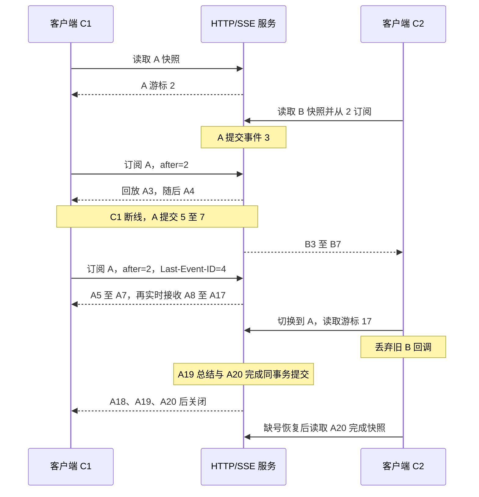

# AI Panel Studio 前后端 API 文档

## 一、文档概述

- **项目名称** AI Panel Studio
- **接口基础地址** `http://127.0.0.1:8080/api/v1` 为本地联调示例。前端从同源入口使用相对路径 `/api/v1`。本文接口路径均相对于该基础地址。
- **接口版本** `v1`，由基础路径标识。
- **认证方式** 本地单实例，接口无需用户登录和 token。模型 API Key 由后端环境变量提供。
- **请求头通用规则**
  - 常规 API 使用 `Accept: application/json`。携带 JSON 请求体的接口使用 `Content-Type: application/json`。
  - SSE 使用 `Accept: text/event-stream`，重连头见订阅接口。
  - 所有请求须通过服务端的 `Host` 检查。状态变更请求携带 `Origin` 时，须匹配配置的本地来源。未携带 `Origin` 的本地命令行请求仍须通过 `Host` 检查。

## 二、通用约定

### 2.1 数据格式和字段

- 请求体和常规响应使用 UTF-8 编码的 `application/json`，字段名使用 `camelCase`。SSE 握手成功使用 `text/event-stream`，每个事件的 `data` 仍为 JSON。SSE 握手失败按常规 JSON 响应处理。
- 带 JSON 请求体的接口接收一个完整对象，拒绝重复键、未知字段和尾随文本。选填入参用省略表示。标注可空的响应字段始终返回，空值为 `null`。空集合用 `[]`。
- 创建议题先按 NFC 规范化，将制表符和换行折叠为空格并去除首尾空白。拒绝 NUL、其余控制字符以及双向覆盖或隔离控制符。移除开头 BOM 和无语义的零宽空格 `U+200B`。长度按规范化后的 Unicode 码点数计算。 [输入规范](./AI圆桌演播厅-分阶段Prompt.md#输入脱敏与生成内容安全)
- 房间 ID 为小写带连字符 UUID。成员与观点 ID 为房间内标识。预设 `slug` 由小写字母、数字及连字符组成。
- 事件序号、发言序号和来源游标均为 JSON 安全整数。事件与发言各自从 1 开始按房间递增。快照事件游标和来源游标可为 0。

### 2.2 分页和时间

- v1 的讨论列表和预设列表返回完整集合，`data` 为数组。当前版本未定义分页请求参数或响应元数据。
- 所有时间使用 UTC ISO 8601 字符串，例如 `2026-11-20T02:00:00Z`。秒的小数位可省略，提供时为 1–9 位。`timestamp` 是响应生成时间，`occurredAt` 是已提交事件的时间，`createdAt` 是发言创建时间。结束时间不得早于开始时间。

### 2.3 统一返回体

- `code`（字符串，必填）成功时为 `OK`，失败时为业务错误码。
- `message`（字符串，必填）为中文提示，可用于展示。
- `data`（必填）成功时为对应接口的业务数据，失败时为 `null`。
- `timestamp`（时间字符串，必填）为响应生成时间。
- SSE 成功连接使用事件流，终态追平的 HTTP `204` 使用空响应体。

```json
{
  "code": "OK",
  "message": "成功",
  "data": [],
  "timestamp": "2026-11-20T02:00:00Z"
}
```

### 2.4 通用错误码

- HTTP `400/B0001` 表示参数错误，`403/B0006` 表示请求来源被拒绝，`404/B0002` 表示资源不存在。
- HTTP `409/B0003` 表示状态冲突，`429/B0004` 表示容量已满，`500/B0005` 表示本地系统异常。
- HTTP `502/B9001` 表示上游调用或输出校验失败，`503/B4001` 表示模型配置缺失，`504/B9002` 表示上游超时。
- 客户端按 HTTP 状态和业务码处理错误。具体触发条件见 [错误码字典](#41-错误码字典)。

## 三、接口列表

### 3.1 查询进行中的讨论

- **请求方法** `GET`
- **接口路径** `/discussions`
- **接口描述** 获取大厅正在直播或正在总结的讨论。按 `startedAt` 降序排列，时间相同时按 `id` 升序。

#### 请求头

无需 token。使用 `Accept: application/json`。请求体为空。

#### 请求参数

- Query `status`（字符串，选填）仅支持 `ACTIVE`，省略时也为 `ACTIVE`。
- Body 为空。

#### 请求示例

以下 JSON 表示路径和查询参数。实际请求通过 URL 传参，请求体为空。

```json
{"query":{"status":"ACTIVE"}}
```

#### 响应参数

通用包装字段见 [统一返回体](#23-统一返回体)。

- `data` 是房间摘要数组，空列表为 `[]`。
- `data[].id`（UUID）为房间 ID，`data[].topic`（字符串）为议题。
- `data[].status`（枚举）为 `RUNNING` 或 `SUMMARIZING`。
- `data[].expertCount`（整数）为专家数量，`data[].startedAt`（时间字符串）为开始时间。

#### 成功响应示例

HTTP `200`。

```json
{
  "code": "OK",
  "message": "成功",
  "data": [
    {
      "id": "00000000-0000-4000-8000-00000000000a",
      "topic": "中小团队应优先自研还是采购 AI 客服？",
      "status": "RUNNING",
      "expertCount": 2,
      "startedAt": "2026-11-20T02:00:01Z"
    },
    {
      "id": "00000000-0000-4000-8000-00000000000b",
      "topic": "如何设计百人公司的混合办公规则？",
      "status": "RUNNING",
      "expertCount": 2,
      "startedAt": "2026-11-20T02:00:01Z"
    }
  ],
  "timestamp": "2026-11-20T02:00:45Z"
}
```

#### 失败响应示例

`400/B0001` 参数错误，`403/B0006` Host 拒绝，`500/B0005` 本地服务异常。

HTTP `400` 示例。

```json
{"code":"B0001","message":"请求参数无效","data":null,"timestamp":"2026-11-20T02:00:45Z"}
```

### 3.2 新建讨论草稿

- **请求方法** `POST`
- **接口路径** `/discussions`
- **接口描述** 根据议题和专家人数生成阵容。R01 输出和阵容校验通过后保存草稿。创建失败时回滚本次写入。

#### 请求头

无需 token。使用 `Accept: application/json` 和 `Content-Type: application/json`。浏览器写请求的 `Origin` 须通过通用规则。

#### 请求参数

- Query 为空。
- Body `topic`（字符串，必填）为议题，按通用规则规范化后须为 3–120 个 Unicode 码点。
- Body `expertCount`（整数，选填）取 2–6，省略时取 4。显式 `null` 非法。

#### 请求示例

以下为实际发送的 JSON 请求体。

```json
{"topic":"中小团队应优先自研还是采购 AI 客服？","expertCount":2}
```

#### 响应参数

通用包装字段见 [统一返回体](#23-统一返回体)。

- `id`（UUID）为房间 ID。`topic`（字符串）为议题。`expertCount`（整数）为专家数，范围 2–6。
- `discussionGoal`（枚举）由有效 R01 或预设确定并写入草稿。后续阶段使用持久化值。阶段号和报名窗口号由后端保管。
- `status`（`DiscussionStatus`）为房间状态。`startedAt`、`endedAt`（时间字符串或 `null`）以及 `errorCode`（业务码或 `null`）按状态返回。
- `participants`（`Participant[]`）包含 1 位主持和指定数量的专家。主持排首位，专家按成员 ID 升序。成员 ID、姓名和色标在房间内唯一。
- `transcript`（`Utterance[]`）按发言序号升序。`insights`（`Insight[]`）为当前完整结论投影。
- `insightStatus`（`InsightStatus`）为提炼状态。`insightsThroughUtteranceSeq`（非负整数）为该投影覆盖的最新专家发言序号。没有成功投影时为 0，对应数据库的 SQL `NULL`。
- `summary`（字符串或 `null`）在完成时返回两句中立收尾。主持归因整理专家观点、共识范围、未决分歧与证据缺口。`lastEventSeq`（非负整数）用于接续 SSE，与快照内容来自同一只读事务。
- 草稿的实录和结论均为 `[]`，`insightStatus` 为 `PENDING`，两个游标均为 0，`startedAt`、`endedAt`、`errorCode`、`summary` 均为 `null`。完整子对象见 [响应对象字典](#43-响应对象字典)。

#### 成功响应示例

HTTP `201`。响应头 `Location: /api/v1/discussions/00000000-0000-4000-8000-00000000000a`。

```json
{
  "code": "OK",
  "message": "成功",
  "data": {
    "id": "00000000-0000-4000-8000-00000000000a",
    "topic": "中小团队应优先自研还是采购 AI 客服？",
    "expertCount": 2,
    "discussionGoal": "EVALUATE",
    "status": "DRAFT",
    "startedAt": null,
    "endedAt": null,
    "errorCode": null,
    "participants": [
      {
        "id": "host",
        "role": "HOST",
        "displayName": "顾言",
        "profession": "节目主持",
        "title": "圆桌主持人",
        "stance": null,
        "perspective": null,
        "colorKey": "violet",
        "stageStatus": "IDLE",
        "publicFocus": null
      },
      {
        "id": "e1",
        "role": "EXPERT",
        "displayName": "陈简",
        "profession": "成本管理",
        "title": "成本控制负责人",
        "stance": "四周内交付时优先采购成熟方案",
        "perspective": "COST",
        "colorKey": "blue",
        "stageStatus": "IDLE",
        "publicFocus": null
      },
      {
        "id": "e2",
        "role": "EXPERT",
        "displayName": "林昭",
        "profession": "软件工程",
        "title": "平台架构师",
        "stance": "规则频繁变更时维护自研编排",
        "perspective": "DELIVERY",
        "colorKey": "green",
        "stageStatus": "IDLE",
        "publicFocus": null
      }
    ],
    "transcript": [],
    "insightStatus": "PENDING",
    "insightsThroughUtteranceSeq": 0,
    "insights": [],
    "summary": null,
    "lastEventSeq": 0
  },
  "timestamp": "2026-11-20T02:00:45Z"
}
```

#### 失败响应示例

`400/B0001` 参数错误，`403/B0006` 来源拒绝，`500/B0005` 本地异常，`502/B9001` 上游调用或输出校验失败，`503/B4001` 模型配置缺失，`504/B9002` 上游超时。

HTTP `502` 示例。

```json
{"code":"B9001","message":"暂时无法生成合格的专家阵容","data":null,"timestamp":"2026-11-20T02:00:45Z"}
```

### 3.3 查询预设讨论

- **请求方法** `GET`
- **接口路径** `/presets`
- **接口描述** 返回系统预设议题、目标和阵容。初始化后至少有 5 条，按 `slug` 升序。

#### 请求头

无需 token。使用 `Accept: application/json`。请求体为空。

#### 请求参数

- Query 为空。
- Body 为空。

#### 请求示例

以下 JSON 表示参数为空。实际请求体为零字节。

```json
{}
```

#### 响应参数

通用包装字段见 [统一返回体](#23-统一返回体)。

- `data` 是预设数组。
- `data[].slug`（字符串）为预设标识。`data[].topic`（字符串）为议题。
- `data[].discussionGoal`（`DiscussionGoal`）为预设目标，`data[].expertCount`（整数）为专家数。
- `data[].participants`（`PresetParticipant[]`）为预设阵容。字段见 [响应对象字典](#43-响应对象字典)。

#### 成功响应示例

HTTP `200`。

```json
{
  "code": "OK",
  "message": "成功",
  "data": [
    {
      "slug": "ai-support-buy-build",
      "topic": "中小团队应优先自研还是采购 AI 客服？",
      "discussionGoal": "EVALUATE",
      "expertCount": 4,
      "participants": [
        {
          "id": "host",
          "role": "HOST",
          "displayName": "顾言",
          "profession": "节目主持",
          "title": "圆桌主持人",
          "stance": null,
          "perspective": null,
          "colorKey": "violet"
        },
        {
          "id": "e1",
          "role": "EXPERT",
          "displayName": "陈简",
          "profession": "成本管理",
          "title": "成本控制负责人",
          "stance": "四周内交付时优先采购成熟方案",
          "perspective": "COST",
          "colorKey": "blue"
        },
        {
          "id": "e2",
          "role": "EXPERT",
          "displayName": "林昭",
          "profession": "软件工程",
          "title": "平台架构师",
          "stance": "规则频繁变更时维护自研编排",
          "perspective": "DELIVERY",
          "colorKey": "green"
        },
        {
          "id": "e3",
          "role": "EXPERT",
          "displayName": "赵岚",
          "profession": "客服运营",
          "title": "客户运营经理",
          "stance": "小流量核验服务效果再逐步拓展",
          "perspective": "EVIDENCE",
          "colorKey": "amber"
        },
        {
          "id": "e4",
          "role": "EXPERT",
          "displayName": "方钰",
          "profession": "隐私工程",
          "title": "隐私工程师",
          "stance": "优先明确数据留存和迁移权利",
          "perspective": "RISK",
          "colorKey": "rose"
        }
      ]
    },
    {
      "slug": "city-curb-space",
      "topic": "市中心路边停车位应改为配送与无障碍上下客区吗？",
      "discussionGoal": "EVALUATE",
      "expertCount": 4,
      "participants": [
        {
          "id": "host",
          "role": "HOST",
          "displayName": "贾晨",
          "profession": "节目主持",
          "title": "圆桌主持人",
          "stance": null,
          "perspective": null,
          "colorKey": "violet"
        },
        {
          "id": "e1",
          "role": "EXPERT",
          "displayName": "冯远",
          "profession": "交通规划",
          "title": "交通规划师",
          "stance": "按道路功能与通行时段分配路缘",
          "perspective": "GOVERNANCE",
          "colorKey": "blue"
        },
        {
          "id": "e2",
          "role": "EXPERT",
          "displayName": "唐立",
          "profession": "商户运营",
          "title": "沿街商户代表",
          "stance": "保留便于经营交付的短时停车",
          "perspective": "COST",
          "colorKey": "green"
        },
        {
          "id": "e3",
          "role": "EXPERT",
          "displayName": "马会",
          "profession": "城市配送",
          "title": "城市配送调度员",
          "stance": "先在配送高峰减少双排停车",
          "perspective": "DELIVERY",
          "colorKey": "amber"
        },
        {
          "id": "e4",
          "role": "EXPERT",
          "displayName": "秦宜",
          "profession": "无障碍出行",
          "title": "无障碍出行顾问",
          "stance": "确保上下客通道全程保持连续",
          "perspective": "USER_IMPACT",
          "colorKey": "rose"
        }
      ]
    },
    {
      "slug": "hybrid-work-policy",
      "topic": "如何设计百人公司的混合办公规则？",
      "discussionGoal": "PROPOSE",
      "expertCount": 4,
      "participants": [
        {
          "id": "host",
          "role": "HOST",
          "displayName": "许明",
          "profession": "节目主持",
          "title": "圆桌主持人",
          "stance": null,
          "perspective": null,
          "colorKey": "violet"
        },
        {
          "id": "e1",
          "role": "EXPERT",
          "displayName": "周弦",
          "profession": "人事管理",
          "title": "人力资源负责人",
          "stance": "由团队自行安排主要协作工作日",
          "perspective": "GOVERNANCE",
          "colorKey": "blue"
        },
        {
          "id": "e2",
          "role": "EXPERT",
          "displayName": "郑弋",
          "profession": "软件工程",
          "title": "工程团队经理",
          "stance": "异步优先并减少统一到岗要求",
          "perspective": "DELIVERY",
          "colorKey": "green"
        },
        {
          "id": "e3",
          "role": "EXPERT",
          "displayName": "姜平",
          "profession": "空间管理",
          "title": "设施运营主管",
          "stance": "固定到岗日期便于空间规划安排",
          "perspective": "COST",
          "colorKey": "amber"
        },
        {
          "id": "e4",
          "role": "EXPERT",
          "displayName": "苏晓",
          "profession": "无障碍研究",
          "title": "无障碍项目顾问",
          "stance": "按办公可达性设置可申请的例外",
          "perspective": "USER_IMPACT",
          "colorKey": "rose"
        }
      ]
    },
    {
      "slug": "museum-ai-guide",
      "topic": "博物馆应上线可追问的生成式 AI 导览吗？",
      "discussionGoal": "EVALUATE",
      "expertCount": 4,
      "participants": [
        {
          "id": "host",
          "role": "HOST",
          "displayName": "夏澄",
          "profession": "节目主持",
          "title": "圆桌主持人",
          "stance": null,
          "perspective": null,
          "colorKey": "violet"
        },
        {
          "id": "e1",
          "role": "EXPERT",
          "displayName": "任青",
          "profession": "展览策划",
          "title": "展览策展人",
          "stance": "严格限定可引用的馆藏证据材料",
          "perspective": "EVIDENCE",
          "colorKey": "blue"
        },
        {
          "id": "e2",
          "role": "EXPERT",
          "displayName": "田朗",
          "profession": "互动产品",
          "title": "互动产品经理",
          "stance": "先在少数热门展品开展单馆试点",
          "perspective": "DELIVERY",
          "colorKey": "green"
        },
        {
          "id": "e3",
          "role": "EXPERT",
          "displayName": "祝桦",
          "profession": "观众研究",
          "title": "观众研究员",
          "stance": "保留人工入口及低技术门槛导览",
          "perspective": "USER_IMPACT",
          "colorKey": "amber"
        },
        {
          "id": "e4",
          "role": "EXPERT",
          "displayName": "罗澜",
          "profession": "内容编辑",
          "title": "内容编辑主管",
          "stance": "可追溯材料充分后再开放追问",
          "perspective": "RISK",
          "colorKey": "rose"
        }
      ]
    },
    {
      "slug": "school-ai-homework",
      "topic": "中学应允许学生用生成式 AI 完成家庭作业吗？",
      "discussionGoal": "EVALUATE",
      "expertCount": 4,
      "participants": [
        {
          "id": "host",
          "role": "HOST",
          "displayName": "梁青",
          "profession": "节目主持",
          "title": "圆桌主持人",
          "stance": null,
          "perspective": null,
          "colorKey": "violet"
        },
        {
          "id": "e1",
          "role": "EXPERT",
          "displayName": "沈初",
          "profession": "语文教学",
          "title": "语文教师",
          "stance": "保留独立写作与同伴反馈作为评估依据",
          "perspective": "EVIDENCE",
          "colorKey": "blue"
        },
        {
          "id": "e2",
          "role": "EXPERT",
          "displayName": "白原",
          "profession": "数字素养",
          "title": "数字素养教师",
          "stance": "明确引用规则后允许可追溯的辅助",
          "perspective": "GOVERNANCE",
          "colorKey": "green"
        },
        {
          "id": "e3",
          "role": "EXPERT",
          "displayName": "叶秋",
          "profession": "教育研究",
          "title": "教育研究员",
          "stance": "按作业难度开展小规模分层试点",
          "perspective": "DELIVERY",
          "colorKey": "amber"
        },
        {
          "id": "e4",
          "role": "EXPERT",
          "displayName": "葛琴",
          "profession": "家校协作",
          "title": "家校协作主管",
          "stance": "处理设备不平等之后再开放工具",
          "perspective": "USER_IMPACT",
          "colorKey": "rose"
        }
      ]
    }
  ],
  "timestamp": "2026-11-20T02:00:45Z"
}
```

#### 失败响应示例

`400/B0001` 请求参数错误，`403/B0006` Host 拒绝，`500/B0005` 读取或初始化异常。

HTTP `500` 示例。

```json
{"code":"B0005","message":"服务暂时不可用","data":null,"timestamp":"2026-11-20T02:00:45Z"}
```

### 3.4 从预设新建讨论草稿

- **请求方法** `POST`
- **接口路径** `/presets/{slug}/discussions`
- **接口描述** 复制指定预设的议题、目标、人数和阵容，生成独立的房间 ID 和成员 ID。写入失败时回滚。

#### 请求头

无需 token。使用 `Accept: application/json`。浏览器写请求的 `Origin` 须通过通用规则。请求体为空。

#### 请求参数

- Path `slug`（字符串，必填）为预设标识，例如 `hybrid-work-policy`。
- Query 为空。
- Body 为空。

#### 请求示例

以下 JSON 表示路径和查询参数。实际请求通过 URL 传参，请求体为空。

```json
{"params":{"slug":"hybrid-work-policy"}}
```

#### 响应参数

通用包装字段见 [统一返回体](#23-统一返回体)。

- `data` 是处于 `DRAFT` 的完整快照。字段、类型和初始空值见 [新建讨论草稿](#32-新建讨论草稿)。
- `data.discussionGoal`、`data.expertCount` 和成员角色属性来自所选预设。

#### 成功响应示例

HTTP `201`。响应头 `Location: /api/v1/discussions/00000000-0000-4000-8000-00000000000c`。

```json
{
  "code": "OK",
  "message": "成功",
  "data": {
    "id": "00000000-0000-4000-8000-00000000000c",
    "topic": "如何设计百人公司的混合办公规则？",
    "expertCount": 4,
    "discussionGoal": "PROPOSE",
    "status": "DRAFT",
    "startedAt": null,
    "endedAt": null,
    "errorCode": null,
    "participants": [
      {
        "id": "copy-host",
        "role": "HOST",
        "displayName": "许明",
        "profession": "节目主持",
        "title": "圆桌主持人",
        "stance": null,
        "perspective": null,
        "colorKey": "violet",
        "stageStatus": "IDLE",
        "publicFocus": null
      },
      {
        "id": "copy-e1",
        "role": "EXPERT",
        "displayName": "周弦",
        "profession": "人事管理",
        "title": "人力资源负责人",
        "stance": "由团队自行安排主要协作工作日",
        "perspective": "GOVERNANCE",
        "colorKey": "blue",
        "stageStatus": "IDLE",
        "publicFocus": null
      },
      {
        "id": "copy-e2",
        "role": "EXPERT",
        "displayName": "郑弋",
        "profession": "软件工程",
        "title": "工程团队经理",
        "stance": "异步优先并减少统一到岗要求",
        "perspective": "DELIVERY",
        "colorKey": "green",
        "stageStatus": "IDLE",
        "publicFocus": null
      },
      {
        "id": "copy-e3",
        "role": "EXPERT",
        "displayName": "姜平",
        "profession": "空间管理",
        "title": "设施运营主管",
        "stance": "固定到岗日期便于空间规划安排",
        "perspective": "COST",
        "colorKey": "amber",
        "stageStatus": "IDLE",
        "publicFocus": null
      },
      {
        "id": "copy-e4",
        "role": "EXPERT",
        "displayName": "苏晓",
        "profession": "无障碍研究",
        "title": "无障碍项目顾问",
        "stance": "按办公可达性设置可申请的例外",
        "perspective": "USER_IMPACT",
        "colorKey": "rose",
        "stageStatus": "IDLE",
        "publicFocus": null
      }
    ],
    "transcript": [],
    "insightStatus": "PENDING",
    "insightsThroughUtteranceSeq": 0,
    "insights": [],
    "summary": null,
    "lastEventSeq": 0
  },
  "timestamp": "2026-11-20T02:00:45Z"
}
```

#### 失败响应示例

`400/B0001` 参数错误，`403/B0006` 来源拒绝，`404/B0002` 预设不存在，`500/B0005` 本地异常。

HTTP `404` 示例。

```json
{"code":"B0002","message":"资源不存在","data":null,"timestamp":"2026-11-20T02:00:45Z"}
```

### 3.5 确认开始讨论

- **请求方法** `POST`
- **接口路径** `/discussions/{id}/start`
- **接口描述** 首次确认将草稿切换为 `RUNNING`，提交后只派发一次执行任务。活跃房间重复确认时返回其当前状态。终态返回 `409`。检查模型配置和执行配额仅发生在草稿首次确认时。

#### 请求头

无需 token。使用 `Accept: application/json`。浏览器写请求的 `Origin` 须通过通用规则。请求体为空。

#### 请求参数

- Path `id`（UUID，必填）为房间 ID。
- Query 为空。
- Body 为空。

#### 请求示例

以下 JSON 表示路径和查询参数。实际请求通过 URL 传参，请求体为空。

```json
{"params":{"id":"00000000-0000-4000-8000-00000000000a"}}
```

#### 响应参数

通用包装字段见 [统一返回体](#23-统一返回体)。

- `data.id`（UUID）为房间 ID。
- `data.status`（枚举）首次为 `RUNNING`。重复确认活跃房间时为 `RUNNING` 或 `SUMMARIZING`。

#### 成功响应示例

HTTP `202`。

```json
{
  "code": "OK",
  "message": "成功",
  "data": {"id":"00000000-0000-4000-8000-00000000000a","status":"RUNNING"},
  "timestamp": "2026-11-20T02:00:45Z"
}
```

#### 失败响应示例

`400/B0001` 参数错误，`403/B0006` 来源拒绝，`404/B0002` 房间不存在，`409/B0003` 已结束，`429/B0004` 执行槽已满，`500/B0005` 本地异常，`503/B4001` 模型配置缺失。容量不足或配置缺失时可重试确认草稿。任务派发失败时提交失败终态。

HTTP `429` 示例。

```json
{"code":"B0004","message":"容量已满，请稍后重试","data":null,"timestamp":"2026-11-20T02:00:45Z"}
```

### 3.6 查询讨论快照

- **请求方法** `GET`
- **接口路径** `/discussions/{id}`
- **接口描述** 读取任意状态的讨论快照。阵容、实录、结论和 SSE 游标在同一只读事务中取得。终态仍可读取已提交实录。

#### 请求头

无需 token。使用 `Accept: application/json`。请求体为空。

#### 请求参数

- Path `id`（UUID，必填）为房间 ID。
- Query 为空。
- Body 为空。

#### 请求示例

以下 JSON 表示路径和查询参数。实际请求通过 URL 传参，请求体为空。

```json
{"params":{"id":"00000000-0000-4000-8000-00000000000a"}}
```

#### 响应参数

通用包装字段见 [统一返回体](#23-统一返回体)。

- `data` 是完整快照，字段和类型见 [新建讨论草稿](#32-新建讨论草稿)。
- `data.lastEventSeq` 是本次快照覆盖的最后一条已提交事件，可作为首次 SSE 连接的 `after`。
- `data.startedAt`、`data.endedAt`、`data.errorCode`、`data.summary` 的空值规则见 [讨论状态](#讨论状态)。

#### 成功响应示例

HTTP `200`。

```json
{
  "code": "OK",
  "message": "成功",
  "data": {
    "id": "00000000-0000-4000-8000-00000000000a",
    "topic": "中小团队应优先自研还是采购 AI 客服？",
    "expertCount": 2,
    "discussionGoal": "EVALUATE",
    "status": "COMPLETED",
    "startedAt": "2026-11-20T02:00:01Z",
    "endedAt": "2026-11-20T02:00:20Z",
    "errorCode": null,
    "participants": [
      {
        "id": "host",
        "role": "HOST",
        "displayName": "顾言",
        "profession": "节目主持",
        "title": "圆桌主持人",
        "stance": null,
        "perspective": null,
        "colorKey": "violet",
        "stageStatus": "IDLE",
        "publicFocus": null
      },
      {
        "id": "e1",
        "role": "EXPERT",
        "displayName": "陈简",
        "profession": "成本管理",
        "title": "成本控制负责人",
        "stance": "四周内交付时优先采购成熟方案",
        "perspective": "COST",
        "colorKey": "blue",
        "stageStatus": "IDLE",
        "publicFocus": null
      },
      {
        "id": "e2",
        "role": "EXPERT",
        "displayName": "林昭",
        "profession": "软件工程",
        "title": "平台架构师",
        "stance": "规则频繁变更时维护自研编排",
        "perspective": "DELIVERY",
        "colorKey": "green",
        "stageStatus": "IDLE",
        "publicFocus": null
      }
    ],
    "transcript": [
      {
        "seq": 1,
        "participantId": "host",
        "kind": "OPENING",
        "content": "本场讨论采购与自研，请各位说明你们的评估标准和证据出处。",
        "replyToUtteranceSeq": null,
        "createdAt": "2026-11-20T02:00:02Z"
      },
      {
        "seq": 2,
        "participantId": "e1",
        "kind": "EXPERT",
        "content": "A 可先采购完整方案，通过小流量验证首次解决率。",
        "replyToUtteranceSeq": null,
        "createdAt": "2026-11-20T02:00:05Z"
      },
      {
        "seq": 3,
        "participantId": "e2",
        "kind": "EXPERT",
        "content": "A 也应通过小流量验证首次解决率。核心编排可先自研。",
        "replyToUtteranceSeq": 2,
        "createdAt": "2026-11-20T02:00:10Z"
      },
      {
        "seq": 4,
        "participantId": "e1",
        "kind": "EXPERT",
        "content": "A 补充用规则迁移成本作为可退出的判断条件。",
        "replyToUtteranceSeq": 3,
        "createdAt": "2026-11-20T02:00:15Z"
      },
      {
        "seq": 5,
        "participantId": "host",
        "kind": "SUMMARY",
        "content": "两位发言专家都提出用小流量验证首次解决率。陈简倾向采购完整方案，林昭主张自研核心编排，双方对首版方案仍有分歧。",
        "replyToUtteranceSeq": null,
        "createdAt": "2026-11-20T02:00:19Z"
      }
    ],
    "insightStatus": "STALE",
    "insightsThroughUtteranceSeq": 3,
    "insights": [{"id":"i1","kind":"CONSENSUS","text":"先用小流量验证首次解决率","evidenceUtteranceSeqs":[2,3]}],
    "summary": "两位发言专家都提出用小流量验证首次解决率。陈简倾向采购完整方案，林昭主张自研核心编排，双方对首版方案仍有分歧。",
    "lastEventSeq": 20
  },
  "timestamp": "2026-11-20T02:00:45Z"
}
```

#### 失败响应示例

`400/B0001` 参数错误，`403/B0006` Host 拒绝，`404/B0002` 房间不存在，`500/B0005` 本地异常。

HTTP `404` 示例。

```json
{"code":"B0002","message":"资源不存在","data":null,"timestamp":"2026-11-20T02:00:45Z"}
```

### 3.7 订阅讨论事件

- **请求方法** `GET`
- **接口路径** `/discussions/{id}/events`
- **接口描述** 通过服务器发送事件（Server-Sent Events，SSE）回放指定游标之后的已提交事件，并接续实时事件。前端使用浏览器原生 `EventSource`。

#### 请求头

无需 token。SSE 请求使用 `Accept: text/event-stream`。首次连接通过 Query 带上快照游标。浏览器重连时可自动携带 `Last-Event-ID`（十进制数字文本，选填）。

#### 请求参数

- Path `id`（UUID，必填）为房间 ID。
- Query `after`（十进制数字文本，选填）为房间内事件游标。`Last-Event-ID` 和 `after` 均省略时使用 `0`。
- Body 为空。

#### 请求示例

以下 JSON 表示路径和查询参数。实际请求通过 URL 传参，请求体为空。

```json
{"params":{"id":"00000000-0000-4000-8000-00000000000a"},"query":{"after":"2"}}
```

#### 响应参数

- HTTP `200` 使用 `text/event-stream; charset=utf-8` 和 `Cache-Control: no-cache, no-transform`。每帧包括 `id`、`event`、`data`，以空行结束。建议约每 15 秒发送一次 `: heartbeat` 注释，心跳无 ID 且不推进事件游标。
- `id` 为房间内事件序号的十进制文本。`event` 为公开事件名。`data` 是 JSON 对象，包含 `discussionId`（UUID）、`seq`（正整数）、`occurredAt`（时间字符串）和 `payload`（事件载荷）。`id` 等于 `String(data.seq)`。载荷见本节的事件类型。
- HTTP `204` 表示讨论已结束且客户端游标已追平，响应体为空。

#### 成功响应示例

HTTP `200` 的四类事件示例取自同一房间的不同时间点。完整流按序号连续发送。

```text
id: 1
event: discussion.status
data: {"discussionId":"00000000-0000-4000-8000-00000000000a","seq":1,"occurredAt":"2026-11-20T02:00:01Z","payload":{"status":"RUNNING","startedAt":"2026-11-20T02:00:01Z","endedAt":null,"errorCode":null}}

id: 3
event: participant.status
data: {"discussionId":"00000000-0000-4000-8000-00000000000a","seq":3,"occurredAt":"2026-11-20T02:00:03Z","payload":{"participantId":"e1","stageStatus":"PREPARING","publicFocus":"关注关键取舍"}}

id: 10
event: utterance.added
data: {"discussionId":"00000000-0000-4000-8000-00000000000a","seq":10,"occurredAt":"2026-11-20T02:00:10Z","payload":{"seq":3,"participantId":"e2","kind":"EXPERT","content":"A 也应通过小流量验证首次解决率。核心编排可先自研。","replyToUtteranceSeq":2,"createdAt":"2026-11-20T02:00:10Z"}}

id: 17
event: insight.updated
data: {"discussionId":"00000000-0000-4000-8000-00000000000a","seq":17,"occurredAt":"2026-11-20T02:00:17Z","payload":{"insightStatus":"STALE","insightsThroughUtteranceSeq":3,"insights":[{"id":"i1","kind":"CONSENSUS","text":"先用小流量验证首次解决率","evidenceUtteranceSeqs":[2,3]}]}}

```

#### 失败响应示例

`400/B0001` 房间 ID 或有效游标不合法，`403/B0006` Host 拒绝，`404/B0002` 房间不存在，`429/B0004` 订阅配额已满，`500/B0005` 握手阶段发生本地异常。握手失败使用 JSON。流建立后，传输异常关闭连接，讨论失败则发布 `FAILED` 事件。

HTTP `429` 示例。

```json
{"code":"B0004","message":"容量已满，请稍后重试","data":null,"timestamp":"2026-11-20T02:00:45Z"}
```

#### SSE 事件类型

- `discussion.status` 的 `payload` 包含 `status`、`startedAt`、`endedAt`、`errorCode`。这些字段由服务端根据确认、收束、故障或总结生成，和状态变更同事务提交。终态事件位于其事务事件序列的最后。前端应用有效迁移后，在终态关闭连接。
- `participant.status` 的 `payload` 包含 `participantId`（字符串）、`stageStatus`（`StageStatus`）和 `publicFocus`（`PublicFocus` 或 `null`）。R02 提供合法的 `focusCode`，服务端绑定房间内的专家，并按实际准备、获得调用槽、发言和清理阶段更新。前端用已知专家 ID 更新小窗。
- `utterance.added` 的 `payload` 为 `Utterance`。R03、R05、R06、R07 提供正文候选，R02、R06 提供应答目标候选。服务端校验本场引用、生成发言人、发言号、类型与时间，并与发言原子提交。前端核对发言人、连续序号及引用后追加纯文本实录。收到 `SUMMARY` 时在总结区显示主持对专家观点的归因整理。R07 的内部证据数组由服务端校验。
- `insight.updated` 的 `payload` 包含 `insightStatus`（`FRESH` 或 `STALE`）、`insightsThroughUtteranceSeq`（非负整数）和 `insights`（`Insight[]`）。R04 提供观点和证据候选。服务端校验归属、原文和版本后生成观点 ID 及来源游标。前端按事件替换完整投影。收到 `STALE` 时，继续展示旧条目、证据和来源游标，并提示暂缓更新。

服务端生成信封中的房间 ID、序号、时间和 SSE ID，且只发送已提交事件。回滚或未提交的写入没有公开帧。模型候选附加 `roomId`、`discussionId`、状态、时间或游标时，按运行时 Schema 拒绝。R08 如可重试，仍复用原任务契约。 [模型运行时契约](./runtime-contract.schema.json) · [事务规则](./schema.md#状态机与原子写入)

#### 回放与重连

1. 先读快照，再用 `after=<lastEventSeq>` 订阅。读快照后、建立连接前产生的事件也会补齐。服务端按房间查询 `seq > cursor`，以序号升序回放，并沿用同一路径接续实时事件。
2. `Last-Event-ID` 存在时优先使用该头，`after` 不参与游标解析。非法的头直接返回 `400/B0001`。头缺省时才读取 `after`。游标须为单个规范十进制安全整数，范围从 0 到当前房间的最新已提交序号。空串、负数、前导零、非数字、重复的有效入参或超过上界的数均返回 `400/B0001`。
3. 前端核对当前路由、监听令牌、房间和帧结构，再比较 SSE ID 与 `data.seq`。同一会话的重复事件丢弃。序号缺失、帧结构错误或 ID 不一致时关闭旧流、重新取快照并重订阅。成功应用事件后才推进本地游标。切房时取消旧快照请求、更换监听令牌并关闭旧连接。
4. 服务端校验 Host、有来源限制的请求头、路径和游标后，读取房间并检查游标上界、终态和容量。默认最多 16 条全局连接，每房最多 8 条，满时返回 `429/B0004`。断开、异常、超时和终态关闭都释放配额。浏览器的 EventSource 错误回调只提供连接反馈。短时断线优先使用原生重连，持续失败时重取快照并有界重订阅，超过重试上限后显示手动恢复入口。
5. 终态快照直接展示。终态房间的旧游标可继续回放，仍受订阅容量限制。游标已追平时返回空 `204`，不占槽。总结与完成同事务写入，流中先发总结，再发完成状态并关闭。失败快照保留已提交实录。

#### A/B 联调时序



- C1 读取 A2 后，服务端提交 A3。C1 从游标 2 补到 A3，C2 独立收到 B3 至 B7。
- C1 应用 A4 后丢弃重复 A4，断线时以 `after=2`、`Last-Event-ID=4` 重连，从 A5 开始回放。游标 A999 返回 400，订阅配额已满返回 429。
- C2 切到 A17 后丢弃旧房间和旧监听器的回调。漏掉 A18 又收到 A19 时，重新获取一致快照。
- A19 和 A20 暂存后回滚时没有可见帧，成功提交后顺序发出。A18 游标可回放 A19、A20。A20 或 B9 游标得到 204，B9 失败快照仍保有实录。 [联调样例](./contracts/api.fixtures.json)

## 四、附录

### 4.1 错误码字典

- `B0001` · HTTP `400`。路径参数、查询参数、请求体或有效游标不合法。要求零字节请求体的接口提交 `{}` 或 `null` 也按此处理。
- `B0006` · HTTP `403`。任意入口的 `Host` 不在允许范围内，或写请求携带了未允许的 `Origin`。
- `B0002` · HTTP `404`。格式合法的房间 ID 或预设标识找不到记录。
- `B0003` · HTTP `409`。确认开始时房间已经处于终态。
- `B0004` · HTTP `429`。讨论执行槽或 SSE 全局、单房连接配额耗尽。
- `B0005` · HTTP `500`。本地存储、任务派发或其他系统操作失败，可用于异步失败或重启恢复。
- `B9001` · HTTP `502`。新建阵容时上游调用失败，或其输出通过不了校验。
- `B4001` · HTTP `503`。新建讨论或首次确认所需的模型配置缺失。
- `B9002` · HTTP `504`。新建阵容时上游调用超时。
- 运行中的讨论通过 `FAILED` 快照和 `discussion.status.errorCode` 表示异步失败。`DiscussionErrorCode` 取 `B0005`、`B9001` 或 `B9002`。

### 4.2 枚举值说明

#### 讨论状态

- `DRAFT` · 草稿。`startedAt`、`endedAt`、`errorCode`、`summary` 均为 `null`。
- `RUNNING` · 讨论中。提供 `startedAt`，其余三项为 `null`。
- `SUMMARIZING` · 正在总结。提供 `startedAt`，其余三项为 `null`。
- `COMPLETED` · 已完成。提供 `startedAt`、`endedAt` 和两句 `summary`，`errorCode` 为 `null`。
- `FAILED` · 已失败。提供 `startedAt`、`endedAt` 和 `errorCode`，`summary` 为 `null`。
- 合法迁移为 `DRAFT → RUNNING → SUMMARIZING → COMPLETED`，`RUNNING` 和 `SUMMARIZING` 也可进入 `FAILED`。 [状态机](./schema.md#状态机与原子写入)

#### 讨论目标与嘉宾

- `DiscussionGoal` 支持 `EVALUATE`（评估）、`PROPOSE`（提案）、`SOLVE`（排查）、`EXPLORE`（探索）。
- `role` 支持 `HOST`（主持）和 `EXPERT`（专家）。主持界定讨论范围、厘清分歧、请各方举证及溯源并推进阶段。实质立场、假设、业务判断和建议由专家提出。
- 专家的 `Perspective` 支持 `EVIDENCE`（证据）、`DELIVERY`（交付）、`COST`（成本）、`RISK`（风险）、`USER_IMPACT`（用户影响）、`GOVERNANCE`（治理）。同场专家视角互异，主持为 `null`。
- `StageStatus` 支持 `IDLE`（待机）、`PREPARING`（准备发言）、`SPEAKING`（发言中）。主持始终为 `IDLE`，待机时 `publicFocus` 为 `null`。
- `PublicFocus` 取「关注关键取舍」「检验前提假设」「关注证据依据」「关注风险与边界条件」「关注影响范围」「关注实施路径」之一。可空字段使用 `null`。

#### 发言与观点

- `Utterance.kind` 支持 `OPENING`（开场）、`EXPERT`（专家发言）、`FOLLOW_UP`（追问）、`BRIDGE`（串联）、`SUMMARY`（总结）。
- `Insight.kind` 支持 `CONSENSUS`（共识）和 `DISAGREEMENT`（分歧）。
- `InsightStatus` 支持 `PENDING`（尚未提炼）、`FRESH`（已更新）、`STALE`（更新暂缓）。成功投影保留本次完整结果，证据不足时可为空。更新暂缓时保留旧观点、证据及来源游标，SSE 事件序号仍可递增。

### 4.3 响应对象字典

**PresetParticipant**

- `id`、`displayName`、`profession`、`title`、`colorKey` 均为字符串，依次表示成员 ID、姓名、职业、职称和色标。
- `role` 为角色枚举。`stance` 和 `perspective` 都是必填响应字段，主持均返回 `null`。专家的 `stance` 为 8–100 个 Unicode 码点的立场文本，`perspective` 为视角枚举。前端仅给专家展示立场和视角。

**Participant**

- 包含 `PresetParticipant` 的所有字段。
- `stageStatus` 为嘉宾状态枚举，`publicFocus` 为关注标签枚举或 `null`。

**Utterance**

- `seq`（正整数）为房间内发言序号。 `participantId`（字符串）为本场发言人 ID。 `kind` 为发言类别枚举。
- `content`（字符串）为公开正文，普通发言最多 120 个 Unicode 码点，总结最多 200 个。 `createdAt`（时间字符串）为入库时间。
- `replyToUtteranceSeq`（正整数或 `null`）指向本场较早的已提交发言。R02 的 `ADD` 和 `REBUT` 由服务端锁定目标并传给 R03。R06 的 `BRIDGE` 必须引用本次输入中的专家发言，`FOLLOW_UP` 可为空，其中有目标时执行同样的归属校验。开场、总结和无回应目标的专家发言填写 `null`。

**Insight**

- `id`（字符串）为本场观点 ID。 `kind` 为观点分类枚举。 `text`（字符串）为观点正文。
- `evidenceUtteranceSeqs`（正整数数组）包含 2–4 个互异发言序号。引用来自本场至少两位不同专家，且不得超过 `insightsThroughUtteranceSeq`。

### 4.4 联调资料

- 公开 JSON Schema 声明请求、响应和事件结构。第 3.1 至 3.6 节依次使用 `listDiscussions`、`createDiscussion`、`listPresets`、`copyPreset`、`startDiscussion`、`getDiscussion`，取对应名称加 `Request` 或 `Response` 的 `$defs`。请求按 `params`、`query`、`headers`、`body` 拆解。第 3.7 节使用 `streamDiscussionRequest` 和 `sseFrame`，SSE 帧先解析成 `{event,id,data}` 再校验。错误响应使用 `httpError`。 [公开 Schema](./contracts/public-api.schema.json)
- 联调样例包含成功、失败和 A/B 双房间回放，用于复现契约场景。校验脚本使用 Node.js、Ajv 和 `ajv-formats`，在项目根目录运行 `node docs/contracts/verify.cjs`。如模块安装在独立目录，可依次传入 Ajv、`ajv-formats` 的安装路径。 [联调样例](./contracts/api.fixtures.json) · [校验脚本](./contracts/verify.cjs)
- T06 覆盖请求、快照和公开事件结构、内部字段泄露、模型附加字段和事务回滚。E02 覆盖双房间隔离。E04 覆盖回放、缺号恢复、换房和终态。E05 覆盖容量、失败快照及错误码。上述场景可用样例机械校验，应用联调须连接实际后端与浏览器。
