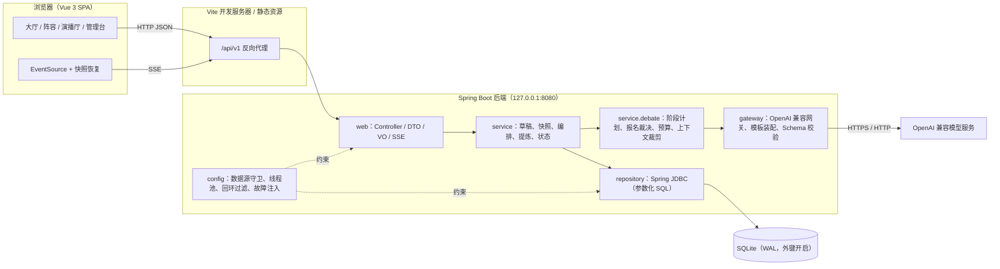
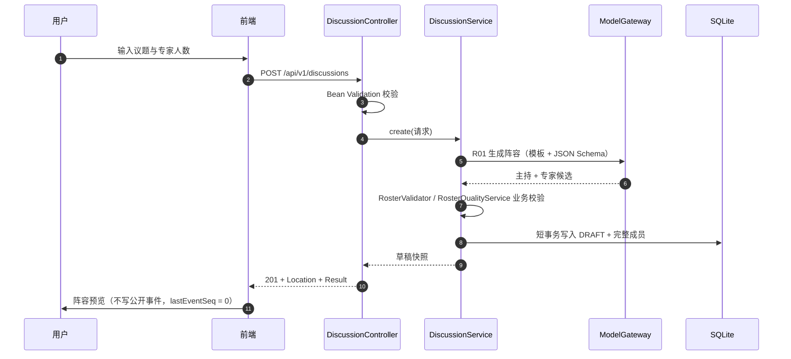
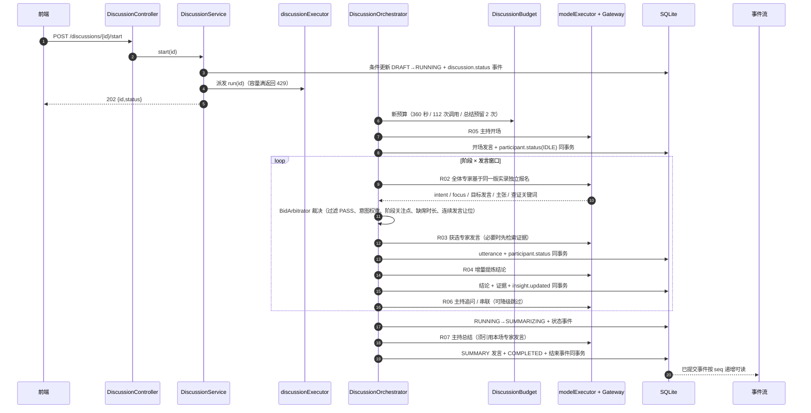
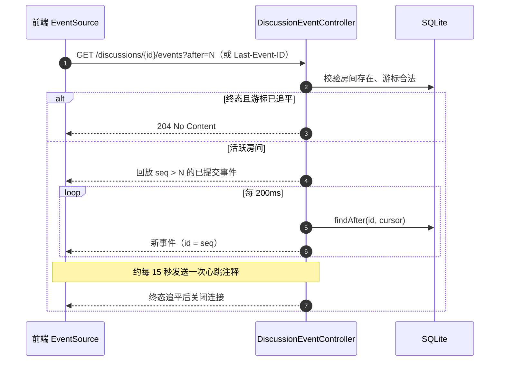

# AI Panel Studio 系统架构与实现说明

本文说明系统的整体架构、模块职责、核心流程、并发与失败边界、以及安全设计。需求口径见 [PRD](./PRD.md)，数据与状态机见 [数据模型与状态机](./schema.md)，接口字段见 [API 文档](./api.md)，本文只讲「为什么这样实现」与「代码如何协同」。

## 1. 架构总览

系统是单实例、前后端分离的本地 Web 应用。浏览器通过 HTTP 读取快照、通过原生 `EventSource` 订阅 SSE；后端由 Spring MVC 提供同步接口与事件流，业务层负责讨论编排，模型调用集中在网关层，SQLite 是唯一持久化存储。

设计要点：

- **模型调用与事务分离**：所有模型请求在事务外执行，结果写回时用「预期状态 + 内容版本」二次校验，过期结果直接丢弃。
- **服务端决定业务事实**：发言顺序、引用归属、结论证据、事件序号都由应用计算，模型只提供候选内容。
- **读路径与写路径分离**：快照是单次只读事务；SSE 按游标轮询已提交事件，不参与写事务。

## 2. 分层与模块职责

后端包结构严格按 `Controller → Service → DAO` 分层，持久化对象不直接作为 HTTP 响应。

| 层 / 包 | 关键类 | 职责 |
| --- | --- | --- |
| `web` | `DiscussionController`、`PresetController`、`AdminController`、`DiscussionEventController`、`SseConnections` | 参数校验、统一 `Result` 包装、SSE 生命周期与连接配额 |
| `service` | `DiscussionService`、`PresetService`、`RosterValidator`、`RosterQualityService`、`DiscussionOrchestrator`、`DiscussionStateService`、`LiveInsightService` | 草稿与快照、预设复制、阵容校验、讨论编排、状态原子写入、实时提炼 |
| `service.debate` | `DiscussionWorkflow`、`PhasePlan`、`BidArbitrator`、`ContextSlice`、`DiscussionBudget`、`RuntimeCalls`、`SpeechEvidenceService` | 阶段计划加载、发言意愿裁决、上下文裁剪、调用与时间预算、证据检索 |
| `repository` | `DiscussionRepository`、`ParticipantRepository`、`UtteranceRepository`、`InsightRepository`、`DiscussionEventRepository`、`JdbcPresetRepository` | 全部参数化 SQL；房间维度查询统一带 `discussion_id` |
| `gateway` | `OpenAiModelGateway`、`ScriptedModelGateway`、`PromptTemplates`、`RuntimeContract`、`ContentGuard` | 供应商协议、模板装配、JSON Schema 与业务校验、敏感内容处理 |
| `config` | `SqlitePathGuard`、`GuardedSqliteDataSource`、`DiscussionExecutionConfiguration`、`LocalRequestGuardFilter` | 数据库路径守卫、线程池、回环 Host/Origin 限制、故障注入钩子 |
| `model` / `util` / `exception` | 行对象、ID 与颜色工具、错误码与全局异常映射 | 与框架无关的数据结构与通用能力 |

前端按页面与能力拆分：

| 位置 | 职责 |
| --- | --- |
| `src/views/LobbyView.vue` | 大厅：议题输入、专家人数、进行中房间列表、预设入口 |
| `src/views/DiscussionView.vue` | 阵容预览与确认开场 |
| `src/views/StudioView.vue` | 演播厅：成员状态、结论区、实录、最终结果弹窗 |
| `src/views/AdminView.vue` | 后台管理台：运行统计、房间检索、快照与事件查看 |
| `src/composables/useDiscussionSession.ts` | 会话生命周期：快照加载、SSE 订阅、重连、离开页面时释放 |
| `src/api/discussion-events.ts` | 事件白名单、序号去重与补缺、结构校验 |
| `src/api/discussions.ts` | HTTP 契约与错误信息归一化 |
| `src/components/studio/*` | Three.js 圆桌场景、虚拟形象、最终结果弹窗 |

## 3. 核心流程

### 3.1 创建草稿（R01）

关键约束：主持的 `stance` / `perspective` 固定为 `null`；专家必须有立场与视角；创建阶段**不写任何公开事件**，因此不会出现在大厅或事件流中。

### 3.2 确认开场与讨论编排（R02–R07）

编排的取舍：

- **报名与裁决分离**：专家只表达「想说什么、想回应谁」，排序由 `BidArbitrator` 按服务端规则计算，模型无法决定谁先发言。
- **连续发言让位**：同一专家连续两条后，只要还有其他候选，就优先让给其他人，既保留「抢答」的真实感，又避免单人霸场。
- **主持介入可降级**：`FOLLOW_UP` / `BRIDGE` 失败只记录日志并复位状态，不打断整场讨论。
- **收尾原子性**：总结正文、`COMPLETED`、结束时间、终态事件在同一事务提交；任一写入失败则整笔回滚并转 `FAILED`，已公开内容继续可读。

### 3.3 实时提炼（R04）

每条专家发言提交后触发一次提炼，流程见 [LiveInsightService](../backend/src/main/java/com/aipanel/service/LiveInsightService.java)：

1. 服务端把本次可用实录切片和引用集合交给模型，模型只返回 `kind/text/evidence`。
2. 应用核对每条 `quote` 必须是本场已提交发言的**连续原文**，且至少覆盖**两位不同专家**；引用归属由应用写库，模型不决定订阅范围。
3. 成功：全量替换该房间结论，写入证据、`FRESH`、来源游标，并发布 `insight.updated`。
4. 失败：保留上一版结论，仅更新 `insight_status=STALE`，并发布全量旧结论事件，前端继续展示可追溯的旧版本。

### 3.4 SSE 回放、重连与去重

浏览器侧由 `readEvent` / `applyEvent` 完成三件事：按事件信封序号去重、检测缺号后重新拉取快照、拒绝不符合状态迁移的状态事件。触发重新加载的条件包括：序号不连续、房间 ID 不匹配、状态机非法跳转。最多自动恢复两次，超过后进入 `offline` 并提供手动重试。

### 3.5 并发仲裁与执行槽

同一草稿可能被重复点击确认。服务端在取得 SQLite 写锁后按房间重读状态：

- 活跃房间返回现有状态（`202`），终态返回 `409/B0003`。
- 仅 `DRAFT` 尝试即时占用执行配额；容量不足时事务结束并返回 `429/B0004`，草稿保留可重试。
- 条件更新 `WHERE id = ? AND status = 'DRAFT'` 影响一行才追加开始事件；只有成功提交者派发任务。
- 失败、回滚、超时、完成都会归还配额；进程重启时扫描遗留 `RUNNING/SUMMARIZING` 并逐房间转 `FAILED`。

## 4. 资源与预算边界

| 资源 | 默认值 | 实现位置 | 行为 |
| --- | --- | --- | --- |
| 同时执行讨论数 | `2`（`panel.orchestration.capacity`） | `discussionExecutor` | 线程数与容量一致，队列满即 `AbortPolicy`，映射为 `429` |
| 模型 I/O 并发 | `capacity × 6` | `modelExecutor` | 与专家上限相乘，避免报名窗口压垮进程 |
| 单场模型调用总量 | `112` 次 | `DiscussionBudget` | 其中为总结保留 2 次 |
| 单场总时长 | `360` 秒 | `DiscussionBudget` | 非总结任务提前 22 秒截止 |
| 单次调用超时 | `10` 秒（R04 放宽到 `28` 秒） | `RuntimeCalls` | 超时按失败处理，允许一次契约修正 |
| 报名窗口截止 | 窗口预算与 20 秒取早 | `RuntimeCalls.earlier` | 单个候选失败不影响其他候选 |
| SSE 连接数 | 全局 `16`、单房间 `8` | `SseConnections` | 满额 `429/B0004`，断开、超时、错误都归还配额 |
| 相邻阶段间隔 | `2500` 毫秒 | `panel.orchestration.stage-delay-millis` | 便于前端观察状态变化，测试可调低 |
| 专家发言上限 | `0`（按进展收尾） | `panel.orchestration.max-expert-utterances` | 显式正数时按总发言数截断 |

## 5. 失败与降级

| 失败点 | 处理方式 | 用户体验 |
| --- | --- | --- |
| 模型配置缺失 | 网关返回 `CONFIG_MISSING`，接口 `503/B4001` | 明确提示未配置模型 |
| 模型超时 / 迟到回包 | `Kind.TIMEOUT` / `STALE_RESPONSE`，丢弃结果 | 讨论转 `FAILED`，已公开实录可回看 |
| 报名窗口部分失败 | 只收集及时返回的候选，日志记录缺口 | 讨论继续，不因个别专家失败中断 |
| 主持追问 / 串联失败 | 记录日志、席位复位 | 自动跳过该次介入 |
| 提炼失败 | 保留旧结论并标记 `STALE` | 结论区显示旧版本与状态提示 |
| 席位写入 / 总结事务失败 | 整体回滚，独立事务转 `FAILED` | 终止事件排最后，前端停止订阅 |
| SSE 断开 | 服务端继续推进，事件持久化 | 重连后按游标补齐，缺号触发快照恢复 |
| 进程重启 | 启动扫描未终态房间 | 统一 `FAILED/B0005`，保留已提交内容 |

## 6. 安全与数据边界

| 风险 | 措施 |
| --- | --- |
| 密钥泄露 | `PANEL_AI_API_KEY` 只从后端进程环境读取，前端 bundle 与接口响应均不含密钥 |
| 越权访问本机服务 | `LocalRequestGuardFilter` 校验回环 Host 白名单；写请求校验 Origin 端口白名单 |
| SQL 注入 | 全部 Spring JDBC 参数化；动态条件只拼列名常量，不拼用户值 |
| 路径穿越 | `SqlitePathGuard` 在建立连接前校验数据库路径必须位于 `allowed-root`，拒绝符号链接逃逸 |
| XSS | 前端只用文本插值渲染模型内容，不渲染 HTML；事件 payload 经过白名单字段校验 |
| 模型幻觉与越权 | 系统模板与业务数据分消息传入；输出执行 JSON Schema + 业务校验；隐藏推理字段直接丢弃 |
| 隐私 | 日志不打印密钥、完整模型原始响应与用户隐私数据；对外 DTO 不含调度分数与报名候选 |
| 连接耗尽 | SSE 全局 / 单房间配额、`SseEmitter` 超时、租约式释放 |

## 7. 可观测性

- 讨论执行日志包含房间 ID、停止原因、模型调用次数与失败类别；异常路径记录完整堆栈。
- `/api/v1/admin/*` 提供状态计数、记录量、房间明细与完整事件流，用于本地排障。
- 管理台每 2 秒轮询，仅在存在 `RUNNING/SUMMARIZING` 房间或打开详情时刷新，终态后停止请求。
- 日志文件默认写入 `logs/panel.log`，级别由 `logging.level.com.aipanel` 控制。

## 8. 关键设计取舍

| 决策 | 选择 | 替代方案与原因 |
| --- | --- | --- |
| 实时通道 | SSE + 游标回放 | WebSocket 需要额外握手与重连协议；SSE 原生支持 `Last-Event-ID`，回放语义更简单 |
| 持久化 | SQLite + WAL + 短事务 | 本地单实例交付成本最低；WAL 允许读快照与写事务并发 |
| 发言调度 | 服务端裁决 + 模型仅报名 | 让模型决定顺序会产生不可复现、难测试的行为 |
| 结论生成 | 每条专家发言后增量提炼 | 结束后一次性生成无法满足「实时共识与分歧」要求 |
| 前端状态 | 快照 + 事件增量重放 | 只依赖事件流会在断线时丢失上下文；快照 + 游标可精确恢复 |
| 视觉实现 | Three.js 场景 + 降级 flat 模式 | 纯 CSS 难以表现坐姿与视线；无 WebGL 环境自动回退保证可用性 |

## 9. 相关文档

- [PRD](./PRD.md)：需求、验收与非目标
- [数据模型与状态机](./schema.md)：ER 图、字段字典、原子写入
- [API 文档](./api.md)：接口、错误码、SSE 契约
- [测试文档](./testing.md)：测试分层、命令与实测记录
- [E2E 测试用例](./e2e-test-cases.md)：系统级验收明细
- [运行时 Prompt 规格](../prompts/README.md)：R01–R08 模板与装配顺序
