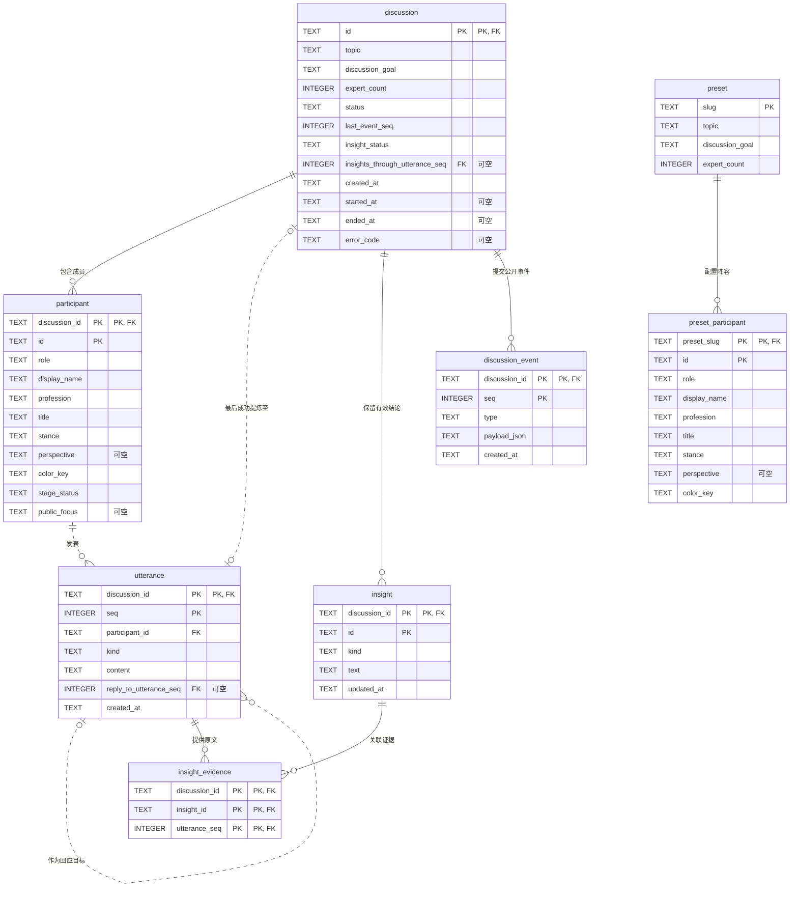
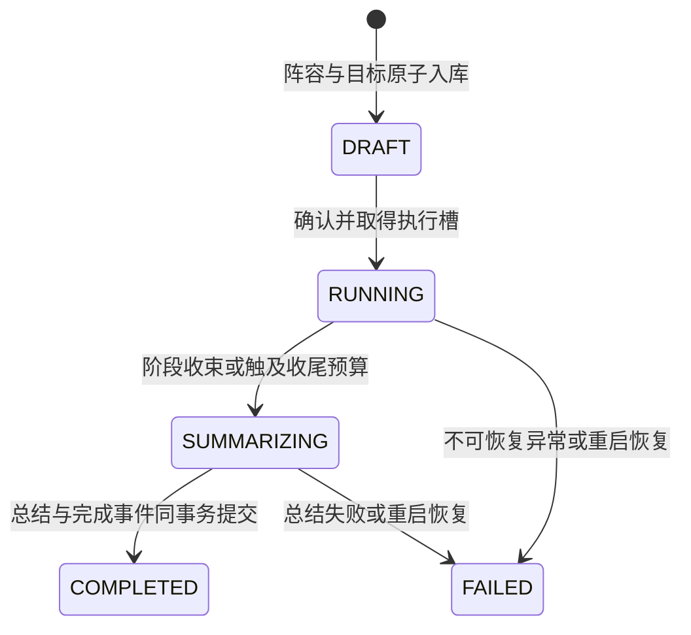

# AI Panel Studio SQLite 数据模型与状态机

本文定义 P01 的数据和状态规格。SQLite 保存房间、成员、实录、当前有效结论、公开事件和预设。单实例后端为房间的唯一写入入口。数据结构结合产品需求、工程设计及模型契约阅读。 [产品需求](./PRD.md) · [工程设计](./AI圆桌演播厅-产品与工程设计.md) · [运行时 Prompt 规格](../prompts/runtime.md) · [运行时契约](./runtime-contract.schema.json)

## 实体关系

图中关系基数以 SQLite 外键约束为准。发言通过成员归属房间，发言回应、提炼游标和结论证据均通过复合外键绑定同一房间。主持只负责引导讨论，业务立场、假设和判断由专家席位提供。应用负责校验房间和预设阵容各有 1 位主持及 2–6 位专家，并确保每条有效结论关联至少两位不同专家的发言。复制预设时生成独立房间和成员记录。

## 字段字典

数据库使用 `snake_case`，公开字段使用 `camelCase`。除注明可空外均必填。时间由服务端生成并以 UTC ISO 8601 文本存储，保持统一精度。房间 ID 为 UUID 字符串。成员和结论 ID 在各自房间内标识记录。预设根据 `slug` 查找，运行房间保存独立数据副本。

| 表 | 字段和类型 | 字段归属与公开方式 |
| --- | --- | --- |
| `discussion` | `id`、`topic`、`discussion_goal`、`status` 为 TEXT。 `expert_count`、`last_event_seq`、可空的 `insights_through_utterance_seq` 为 INTEGER。 `insight_status`、`created_at`、可空的 `started_at`、`ended_at`、`error_code` 为 TEXT。 | R01 候选或预设提供目标，后端校验并随草稿保存。创建和详情回传 `discussionGoal`。状态、时间、错误码和游标由应用写入。`lastEventSeq` 初始为 0。来源游标的 SQL `NULL` 序列化为 `insightsThroughUtteranceSeq=0`。 |
| `participant` | `(discussion_id,id)` 为主键。 `role`、`display_name`、`profession`、`title`、可空的 `stance`、可空的 `perspective`、`color_key`、`stage_status`、可空的 `public_focus` 均为 TEXT。 | 角色为 `HOST/EXPERT`。应用生成 ID、色标和运行状态。主持的 `stance`、`perspective` 均为 `NULL`。专家的立场为 8–100 个 Unicode 码点的有效文本，视角为契约枚举。仅发布由合法 `focusCode` 映射的公开关注点，待机时清空。 |
| `utterance` | 主键 `(discussion_id,seq)`。 `seq` 和可空的 `reply_to_utterance_seq` 为 INTEGER。 `participant_id`、`kind`、`content`、`created_at` 为 TEXT。 | 发言类型为 `OPENING/EXPERT/FOLLOW_UP/BRIDGE/SUMMARY`。应用分配序号并合并验证过的句子。详情的 `summary` 取本场 `SUMMARY` 正文，无记录则为 `null`。 |
| `insight` | 主键 `(discussion_id,id)`。 `kind`、`text`、`updated_at` 为 TEXT。 | `kind` 取 `CONSENSUS/DISAGREEMENT`。最新一次成功提炼全量替换该房间的结论。应用生成 ID 和时间。 |
| `insight_evidence` | 主键 `(discussion_id,insight_id,utterance_seq)`。 `utterance_seq` 为 INTEGER，其余为 TEXT。 | 应用用候选 `quote` 核对入库原文，持久化经过验证的发言引用。公开字段为 `evidenceUtteranceSeqs`，可定位完整原文。 |
| `discussion_event` | 主键 `(discussion_id,seq)`。 `seq` 为 INTEGER。 `type`、`payload_json`、`created_at` 为 TEXT。 | 服务端生成事件类型、序号、时间和白名单 payload。回放由列数据装配信封，`created_at` 对应 `occurredAt`。 |
| `preset` | `slug` 为 TEXT 主键。 `topic`、`discussion_goal` 为 TEXT，`expert_count` 为 INTEGER。 | 种子配置显式提供目标。复制时按目标和人数创建独立草稿。 |
| `preset_participant` | 主键 `(preset_slug,id)`。 `role`、`display_name`、`profession`、`title`、可空的 `stance`、可空的 `perspective`、`color_key` 为 TEXT。 | 预设成员有独立标识。主持的立场和视角均为 `NULL`，专家须提供立场及视角。复制时生成新成员 ID，初始状态为 `IDLE`。 |

| `discussion_goal` | 讨论目标 | 阶段默认路径 |
| --- | --- | --- |
| `EVALUATE` | 比较现有选项或判断已有主张 | 比较标准 → 检验条件与反证 → 有条件的建议 |
| `PROPOSE` | 形成新方案或实施计划 | 提出路径 → 检验可行性 → 定义首轮试点 |
| `SOLVE` | 诊断已知异常、止损或恢复 | 原因假设 → 区分性检查 → 行动优先级 |
| `EXPLORE` | 梳理开放议题与解释边界 | 梳理不同视角 → 检验解释边界 |

四个取值均与 R01 的 `$defs.discussionGoal` 一致。新草稿必须显式提供合法值。旧讨论缺失目标时迁移为 `EXPLORE`。目标随草稿持久化后固定。每次开始讨论按该值加载阶段配置。阶段号、窗口号、运行令牌、请求预算和已锁定候选属于后端运行上下文。

## SQLite 结构与约束

根目录的初始化脚本包含完整 DDL 和五条预设，可用于建立空库。版本升级由相应迁移负责。每条 JDBC 连接在事务外启用并验证 `PRAGMA foreign_keys = ON`。应用启动时在文件库核对 WAL，给每条连接设置有界 `busy_timeout`。写事务只包含数据库操作与短时本地判断。语义、归属和跨行不变量的职责见验收表。 [SQLite 初始化脚本](../init.sql)

SQLite `CHECK` 在表达式求值为 `NULL` 时也会通过。必填列显式声明 `NOT NULL`，专家视角等条件列单独检查空值。SQL 长度和枚举作为最后一道检查。应用仍负责 Unicode 规范化、输入安全、句式和角色语义。主键索引用于按房间读取成员、实录、投影和事件。应用按 `discussion_id` 参数化查询，并用 `WHERE discussion_id = ? AND seq > ? ORDER BY seq` 读取事件。

## 状态机与原子写入

`DRAFT` 可重复发起确认请求，只有一次状态迁移成功。`RUNNING` 和 `SUMMARIZING` 出现在大厅。 `COMPLETED`、`FAILED` 是只读终态，详情仍可查。专家状态沿 `IDLE → PREPARING → SPEAKING → IDLE` 变化。准备阶段失败或取消可直接回到 `IDLE`，`SPEAKING` 在取得模型调用槽并开始生成时提交。

| 写入时机 | 同一短事务中的数据与事件 |
| --- | --- |
| R01 成功或复制预设 | 写入 `DRAFT` 和完整成员。初始实录和结论为空，公开游标为 0。创建响应直接提供草稿快照。 |
| 确认开始、进入总结 | 按预期状态更新房间及时间并追加 `discussion.status`。流程详见下方并发约束。 |
| 成员状态、实录 | 成员状态与 `participant.status` 一起提交。发言与 `utterance.added` 一起提交。专家成功落库时同事务清理状态并追加 `IDLE` 事件，失败清理只提交状态变化。每条专家发言提交后触发一次逻辑 R04。 |
| 提炼成功、失败 | 成功时写入完整结论、证据、`FRESH`、来源游标和 `insight.updated`。失败时用现存结论和原来源游标生成全量 `STALE` 事件，业务更新仅写 `insight_status`。 |
| 总结完成 | 验证房间仍为 `SUMMARIZING`，提交必要的成员清理、`SUMMARY` 发言及其 `utterance.added`，再写 `COMPLETED`、结束时间及 `discussion.status`，结束事件排在最后。任一写入或提交失败时整笔回滚。确认回滚且处理无法继续时，由独立事务按预期状态转 `FAILED`。 |
| 失败或启动恢复 | 复核房间仍活跃，将非待机成员重置并发布相应事件，再写 `FAILED`、结束时间及业务错误码，终态事件排在最后。已提交实录、证据和投影继续可读。 |

**同时确认。** 取得 SQLite 写入权后按房间重读状态。活跃房间返回现有状态，终态返回状态冲突。对于 `DRAFT`，只尝试即时获取执行配额。容量不足时结束事务并返回容量错误，草稿可重试。拿到配额后，以 `WHERE id = ? AND status = 'DRAFT'` 条件更新，影响一行才追加开始事件。生产代码应使用明确的写事务，或经并发测试证明等价的 JDBC 实现。仅成功提交者向有界工作池派发任务。失败、回滚、超时和执行完成均归还本次持有的配额。派发失败由独立失败事务收尾。数据库短暂繁忙时有界重试，按已提交状态重新判断。

**重启恢复。** 初始化迁移和种子后，在接收新业务请求前扫描遗留的 `RUNNING/SUMMARIZING`。每个房间独立运行失败事务，使用现有系统异常码 `500` 和结束时间，保留已提交内容并补齐公开状态事件。`DRAFT` 留待确认，原终态可回看。恢复时新进程的槽位和运行令牌从空状态开始。若中途再次重启，已提交的失败房间退出扫描条件，未提交的房间仍可恢复。恢复尚未完成时保持服务未就绪。

**时间窗与回包。** 调用前在同一读事务读取一致房间快照，内部内容版本使用「最大已提交实录序号、最近一次 `insight.updated` 事件序号」，缺失项为 0。模型在事务外运行。回包先核对房间、运行令牌、步骤、尝试号、截止时间和允许引用集合。持久化时在同一写事务再次核对预期状态与内容版本。关闭、过期、重复或已被替代的任务丢弃结果，保留当前任务的独立提交权。单纯的小窗事件推进公开游标时，内容版本仍有效。 [快照版本与结果提交](../prompts/runtime.md#快照版本与结果提交)

**三个序号。** 写事务内按房间分配下一条实录 `utterance.seq`，从 1 开始，通过主键及只追加规则保证单调。每个公开事件以 `last_event_seq + 1` 分配，多个事件连续分配并在同事务更新 `last_event_seq`。结论来源游标记录最后一次完全成功的 R04 所覆盖的最新专家发言序号，随成功投影更新。SSE 在事务成功后读取公开事件。快照在一个读事务中读取投影和 `lastEventSeq`，首次用它构造 `after`，重连优先用 `Last-Event-ID`。浏览器在当前房间按事件信封序号去重与补缺，结束事件消费完再关闭订阅。详细报文由 P02 冻结。

## 回应目标与结论证据

| 边界 | 写入条件 |
| --- | --- |
| R02 → R03 专家回应 | `ADD/REBUT` 的 `targetUtteranceSeq` 必须在本次允许集合内，按 `(discussion_id,seq)` 找到本场已提交且属于其他成员的发言。目标在获选时锁定，R03 输出只含句子。服务端填充 `reply_to_utterance_seq`。`RAISE/BUZZ` 写空目标，`PASS` 无发言。房号由调用上下文绑定，两个房间相同的数字序号各自解析。 |
| R06 主持回应 | 服务端确定 `FOLLOW_UP/BRIDGE`。串联必须引用本次输入的一条专家发言，追问允许为空，有目标时同样验证该目标为本次输入的本场专家发言。模型提出的目标只在校验通过后使用。主持只转述带归属的既有观点，并用提问推进讨论、邀请补证及追溯出处。 |
| R04 结论证据 | 仅引用本场已提交且包含于冻结输入的专家发言，序号不超过该结果的来源游标。每项结论有 2–4 条不同发言引用，涉及至少两位不同专家，每条候选引文是入库正文的确切子串。每类最多 3 条，拒绝重复观点。复合外键和主键约束房间及重复关联，应用检查发言角色、说话者数、引用集合、上界及精确原文。 |
| R04 完整覆盖与降级 | 成功全量结果（包括有效空集合）才推进至本次处理的最新专家发言。核心实录缺失、截断或结果无效时保留之前的结论、证据和来源游标。首次失败可呈现空投影和公开来源 0，同时发布 `STALE`，下一条专家发言后再尝试。此处 SSE 游标可递增，来源游标沿用旧值。 |
| R07 总结证据 | 应用核验 0–6 个不重复的本场专家发言序号及本次允许集合。少于两位有效专家时使用 `LIMITED`。每项具体观点须归因到专家并有相应证据。主持只归纳已有发言、未决分歧与证据缺口，语义由 Q04 检查。总结证据用于提交前验证，本期持久化和公开的总结字段为发言正文。 |

## 迁移与预设

1. 启动阶段串行执行有版本号的 SQL 迁移。空库直接构建目标结构。提交迁移前执行 `PRAGMA foreign_key_check`，通过后将迁移和版本登记同事务提交。失败保持旧版本可恢复。使用一致性 SQLite 备份验证回滚与恢复。
2. 现目录无旧库或迁移脚本，升级路径为规格。旧讨论在目标列缺失或为 `NULL` 时使用 `EXPLORE`，保留已有合法枚举，遇到未知非空值时报迁移错误并回滚。保持房间、成员及既有发言与事件序号。若旧来源游标用 0，迁移为 SQL `NULL`。其他非零游标须解析为该房间真实专家发言。旧数据不满足约束时应报具体表和记录键，禁止静默删除。
3. 如需用 SQLite 重建表来补齐 `NOT NULL/CHECK` 或复合外键，先核对实际旧结构及依赖表。停止业务访问，在独立迁移连接的事务外临时关闭外键，事务内创建新表、显式列复制、替换旧表和重建索引。提交前检查 `foreign_key_check` 为空，否则回滚。结束后在事务外开启并确认外键。新目标列无默认值，普通草稿和预设复制的写入方都必须显式提供。
4. 种子使用稳定 `slug` 和预设内稳定成员 ID。初始化脚本在同一写事务内建立表结构、为缺失的预设写入元数据与完整阵容，并校验已存在预设的目标及阵容数量。需调整目标或修复残缺数据时用显式版本化种子迁移。重复初始化同一版应保持行数及内容一致。复制操作在事务内按 `slug` 读取目标及全组成员，写出可独立确认的新房间，每次复制均产生新房间 ID。

5. 旧版 `init.sql` 建立的数据库先执行 [主持立场迁移](../migrations/002-host-stance.sql)。迁移将房间成员与预设成员的主持立场更新为 `NULL`，同时重建角色约束。保留专家立场、成员 ID 和已有实录及事件，提交前运行外键检查。空库直接运行新版 `init.sql`。旧版数据库执行新版初始化时会因约束版本检查失败并回滚。

| 预设 `slug` | 显式目标 | 阵容 |
| --- | --- | --- |
| `ai-support-buy-build` | `EVALUATE` | 1 位主持 + 4 位专家 |
| `hybrid-work-policy` | `PROPOSE` | 1 位主持 + 4 位专家 |
| `school-ai-homework` | `EVALUATE` | 1 位主持 + 4 位专家 |
| `city-curb-space` | `EVALUATE` | 1 位主持 + 4 位专家 |
| `museum-ai-guide` | `EVALUATE` | 1 位主持 + 4 位专家 |

题目、成员和预设视角沿用 [五条种子样例草案](./AI圆桌演播厅-交付与工作流.md#2-五条种子样例草案)。

## 不变量与验收缺口

编号沿用工程设计。`T` 为确定性单元或集成测试，`E` 为真实前后端端到端（E2E）测试。下方的 SQLite 验证覆盖初始化脚本及指定的事务场景。

| 规格和不变量 | 数据库职责 | 应用职责 | T/E 验收与缺口 |
| --- | --- | --- | --- |
| F02 目标合法且固定 | `NOT NULL/CHECK` 校验四类枚举。 | R01 或预设显式提供合法值，各次推进复用已保存目标。旧记录按迁移规则回填。 | T01/T02/T06、E01/E07 未运行。需覆盖四类目标、旧库升级、非法目标以及目标不可改写。 |
| F02/N01 阵容恰有一位主持和 N 位专家，色标及专家视角唯一 | 部分唯一索引、色标唯一键及角色、立场和视角联合 CHECK。 | 验规范化姓名、恰好人数、色板和目标，阵容与草稿同事务保存。 | T01、E01/E07 未运行。需覆盖 2/4/6 位、重复姓名、错误角色、整组回滚、实际预设数据。 |
| F02/N02 同一草稿只开始一次，两房间可并行 | 条件更新、开始事件原子提交。 | 单个获胜者派发，容量和异常释放，房间终态拒绝迟到写入。 | T05/T06、E01/E02/E05 未运行。需验证并发重复确认、竞争其他房间、线程池拒绝及槽位归还。 |
| F03/F06 回应作用于本场较早发言和本次输入 | 复合外键、正整数和先后 CHECK。 | R02 与 R03 绑定目标，拒绝本人回应与裁剪外目标。R06 走独立的主持目标规则。 | T02/T03/T07/T08、E01 未运行。需覆盖跨房间成员和目标、同号跨房间、旧候选及引用跳转。 |
| F03/F04/F06 公开状态、身份、类型和内容有明确归属 | 角色、状态、正文和发言类型 CHECK，成员复合外键。 | 同窗冻结输入并裁决，角色匹配发言类型，流程驱动小窗，限制句数和公开 DTO，失败清理。 | T02/T03/T07/T08、E01/E03/E05 未运行。需验证隐藏字段拦截、失败无占位发言、准备与发言状态。 |
| F03/F07 开场先于报名，阶段、窗口与请求预算有上限 | 已提交发言按房间顺序可查。 | 按固定类型和已提交实录推进，区分全员 `PASS` 和整窗故障，为总结预留资源，丢弃超时回包。 | T02/T07/T08、E01/E05 未运行。需覆盖四类阶段、配额耗尽、超时与有限总结。 |
| F05 证据同房间、有原文、至少两位专家 | 证据复合外键及去重主键。 | 查本场专家、原文、冻结输入与上界，限制每类条数。 | T04/T06/T08、E03 未运行。需覆盖同一专家、多房间、未来发言、伪造引文。语义 Q03 未运行。 |
| F05 成功投影与来源游标一致，暂缓保留旧数据 | 来源复合外键、状态和空值 CHECK，投影与事件短事务。 | `FRESH` 推进至最新专家发言，`STALE` 保留上版内容和游标，丢弃过期结果。 | T04/T06/T08、E03/E04 未运行。需对比暂缓前后的精确行、公开游标和旧回包路径。 |
| F06/N02 快照和历史回放正确，事件随业务提交 | 事件复合主键，读写事务边界。 | 按房间分配序号，事务后回放，消费端校验房间与会话并处理缺号。 | T06/T08、E02/E04/E05 未运行。需验证发言插入与事件回滚、切房、快照间隙和重连。 |
| F07 总结存在才完成，插入失败保留旧实录 | 部分唯一索引限制一条总结，原子事务。 | 先写总结及其事件再写完成，失败整笔回滚，再按状态提交失败收尾。 | T07/T06、E01/E04/E05 未运行。需分别注入总结插入、事件写入及完成更新失败。语义 Q04 未运行。 |
| N02 失败及重启后仅保留可回看的已提交输出 | 状态字段组合 CHECK，恢复事务写入状态与事件。 | 重启逐房间处理活跃记录并复位专家，提交失败终态，重复恢复可重入。 | T06、E05 未运行。需补充实际进程中止、两种活跃状态、重复恢复及事件回放样本。 |
| N01 初始化与预设复制 | 版本登记、稳定复合键和外键。 | 空库迁移，旧数据保留，五条预设含完整阵容，可重复初始化并独立复制。 | T01/T06、E07 未运行。需用实际迁移和种子验证异常回滚、升级后的拓扑、重复初始化和复制。 |

SQLite JDBC、真实连接上的 WAL、锁等待和 JDBC 事务语义待后端集成验证。真实模型的产品验收口径见 [PRD 质量要求](./PRD.md#64-ai-输出质量)。

### 本轮验证记录

工作目录为项目根目录。以 PowerShell 将内联脚本送入 `python -`，执行文档核对及 SQLite 临时文件验证。连接模拟只使用 Python 标准库。

| 范围 | 结果 | 实际证据与边界 |
| --- | --- | --- |
| U01–U04、F01–F07、N01–N03 文档一致性 | PASS | 14 个规格编号、T/E/R/Q 引用、四类枚举、引用文件和五条业务状态边通过静态核对。Mermaid 渲染未运行。 |
| F02/F03/F05/N01 DDL 与关联 | PASS | SQLite 3.45.3 执行提取前的 DDL，核对 CHECK、部分唯一索引、复合外键、WAL 和 `busy_timeout`。样例拒绝跨房间的成员、目标、证据和来源游标。 |
| F02/N02 确认事务 | PASS | 两条 SQLite 连接同时确认同一房间，只提交一个开始事件。应用派发与槽位未运行。 |
| F05 STALE 事务 | PASS | 样例保留原结论、两条证据和来源游标，公开游标递增。模型处理及 SSE 未运行。 |
| F07/N02 总结回滚与恢复 | PASS | 注入完成更新失败后，总结、事件和游标共同回滚。关闭连接并重开数据库，按样例恢复两个活跃房间，第二次扫描为 0，已提交实录保留。实际应用进程中止未运行。 |
| N01 回填样例 | PASS | 模拟旧记录缺目标时回填 `EXPLORE`，保留已有合法目标并拒绝非法枚举。真实迁移未运行。 |
| N01 独立初始化脚本 | PASS | 通过 `python -` 和标准库 SQLite 3.45.3 执行根目录 `init.sql`。空库建立 8 张表、6 个显式索引、5 条预设和 25 位成员，通过完整性及外键检查。重复执行保留已有数据。构造残缺阵容后执行，断言本次新增预设回滚。应用启动与 JDBC 集成未运行。 |

第一次 SQLite 验证在系统临时目录打开数据库时失败，命令退出码为 1，输出 `sqlite3.OperationalError: unable to open database file`。改用工作区临时数据库重跑通过，临时库已清理。失败与重跑证据在本轮终端输出。

## 数据与状态核对及 P02 移交

| 位置 | 本轮核对结果及影响 |
| --- | --- |
| 工程设计 §2.2/§2.3 与运行时契约 `$defs.discussionGoal` | 四类枚举、草稿与详情字段一致。显式目标写入和旧记录回填是持久化要求。预设目标沿用工作流给定值。 |
| 工程设计 §2.2/§2.4 与分阶段 Prompt「快照版本与结果提交」 | 本轮采用可空 SQL 来源游标与复合外键，HTTP/SSE 仍以 0 表示无来源。P02 须明确空投影与来源 0 的示例，以及 `STALE` 可递增事件游标。 |
| 工程设计 §2.1 与分阶段 Prompt P01/R07 | 状态图一致。本轮细化为活跃状态内重入确认，提交者派发；启动时按房间恢复失败；总结回滚后独立提交失败终态。P02 须覆盖重复确认、容量冲突与失败终态可回看。 |
| 运行时契约 `bidOutput`/`utteranceOutput`/`interventionOutput`/`summaryOutput` 与公开字段归属 | R02 的目标经后端绑定后才由 R03 发言使用。R06 校验后才写目标。R07 候选的证据数组只供后端提交前校验。P02 的公开 payload 用服务端字段。 |

当前目录缺少 `.git`，`git rev-parse --verify HEAD` 返回退出码 128，失败原文为 `fatal: not a git repository (or any of the parent directories): .git`，无 HEAD 可记录。现有文件为作业原文、`AGENTS.md` 和四份产品、Prompt、运行时契约及交付草案。P02 输入为本页和 PRD、既有 HTTP/SSE 草案及运行时字段归属。现目录缺少迁移、应用及测试，相关实现待核对。P02 的 API 文档和契约样例由下一轮授权范围交付。
