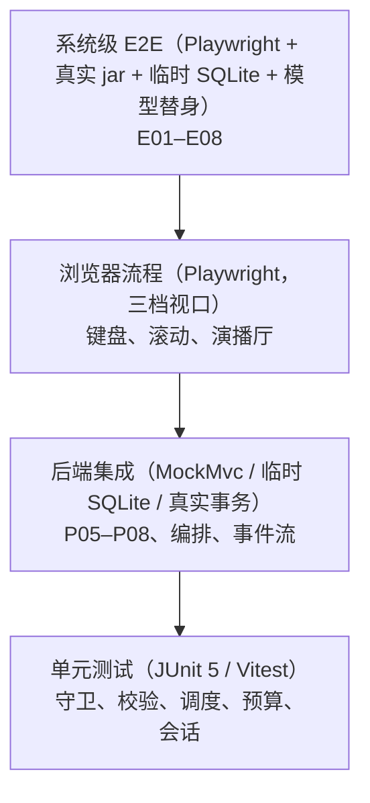

# AI Panel Studio 测试文档

本文说明测试策略、测试分层、覆盖范围、运行方式与真实执行记录。目标是让评审者能在本地复现全部验证，并能从失败断言直接定位到业务规则。

## 1. 测试原则

1. **TDD 驱动核心规则**：阵容校验、发言调度、即时提炼先写失败断言，再实现到绿灯，最后在不改变行为的前提下重构。
2. **真实失败优先**：Red 阶段用「临时移除目标规则」的变异方式复现业务失败，而不是只写一个永远通过的测试。
3. **契约优先**：接口、SSE 事件、模型输出都以 Schema 或夹具约束，测试断言字段名与状态迁移，而不是内部实现细节。
4. **隔离可重复**：后端测试只使用临时 SQLite；模型上游用替身；前端组件测试用内存夹具；系统级 E2E 每轮新建临时库并清理。
5. **失败要能解释**：每条断言对应需求编号或状态机边，失败信息包含实际值，便于区分代码缺陷与环境问题。

## 2. 测试分层



| 层 | 工具 | 运行位置 | 主要目的 |
| --- | --- | --- | --- |
| 单元 | JUnit 5 + AssertJ；Vitest + @vue/test-utils | `backend/src/test/java/com/aipanel/unit`、`frontend/tests/*.spec.ts` | 纯规则与组件行为，秒级反馈 |
| 集成 | Spring Boot Test + MockMvc | `backend/src/test/java/com/aipanel/it` | 真实路由、事务、SQLite 约束、SSE 回放 |
| 浏览器 | Playwright（fixture 服务） | `frontend/tests/browser` | 页面布局、键盘、交互与三档视口 |
| 系统 | Playwright（真实后端 + 假上游） | `frontend/tests/system` | 前后端真实链路的端到端验收 |
| 契约辅助 | Node 脚本 | `docs/contracts/verify.cjs` | 校验接口夹具与运行时 Schema 一致 |

## 3. 后端测试矩阵

| 文件 | 覆盖内容 |
| --- | --- |
| `unit/SqlitePathGuardTest` | 越界路径、`..` 穿越、符号链接逃逸在建连前拒绝（无符号链接权限时跳过一项） |
| `unit/RosterValidatorTest` | 主持唯一、专家数量、色标唯一、立场 / 视角必填与长度 |
| `unit/RosterQualityServiceTest` | 专家立场重复、视角覆盖不足判为低质量 |
| `unit/DiscussionRulesTest` | 发言裁决、连续发言让位、阶段关注点、预算扣减、上下文裁剪 |
| `unit/TopicNormalizerTest`、`unit/SlugsTest` | 议题规范化与 slug 规则 |
| `it/P05*` | 草稿创建、讨论目标推断、阵容失败与回滚、预设读取 / 复制 / 幂等、数据源隔离 |
| `it/P06DiscussionFlowIT` | 确认开场、状态机、重复确认、失败路径 |
| `it/P07EventStreamIT` | SSE 游标回放、`Last-Event-ID`、终态追尾、连接上限 |
| `it/P08AdminIT` | 管理台统计、检索、详情与事件流 |
| `it/P08ModelGatewayIT` | OpenAI 兼容协议、超时、非 2xx、结构异常映射 |
| `it/P08PackagedTemplatesTest` | 打包后的 Prompt 模板可读、版本一致 |
| `it/RuntimeDiscussionIT` | 一场完整讨论的编排、发言、提炼、总结时序 |
| `it/WorkflowTemplateIT` | 四类议题目标的阶段计划与发言名额 |
| `it/DiscussionCleanupIT` | 失败房间删除、终态内容保留 |
| `it/LiveEvidenceIT` | 真实外网证据检索（默认跳过，需显式启用） |
| `service/debate/SpeechEvidenceServiceTest` | 本场引文充分、超时、候选裁剪 |

## 4. 前端测试矩阵

| 文件 | 覆盖内容 |
| --- | --- |
| `tests/discussion-flow.spec.ts` | 大厅议题输入、人数边界、预设卡片与复制、错误提示 |
| `tests/studio-session.spec.ts` | 快照游标订阅、重复 / 跨房间事件过滤、缺号恢复、结论 `STALE`、最终弹窗 |
| `tests/agenda.spec.ts` | 自由发言顺序、连续接话、主持人串联、非轮询渲染 |
| `tests/browser/keyboard.spec.ts` | 键盘导航、焦点管理、弹窗关闭 |
| `tests/browser/studio.spec.ts` | 三档视口布局、独立滚动、窄屏标签页、引用定位 |

## 5. 关键业务断言

| 规则 | 断言要点 |
| --- | --- |
| 阵容 | 主持固定 1 位且 `stance/perspective` 为 `null`；专家 2–6 位；色标唯一；立场不重复 |
| 草稿 | 创建成功不写公开事件，`lastEventSeq=0`；失败时 `discussion`、`participant`、`event` 三表零残留 |
| 确认开场 | `DRAFT → RUNNING` 条件更新；重复确认幂等返回当前状态；终态 `409`；容量满 `429` 且草稿保留 |
| 发言调度 | 服务端过滤 `PASS`；按意图、阶段关注点、缺席时长排序；同一专家连续两条后让位 |
| 提炼 | 引用必须匹配本场原文且覆盖两位以上专家；失败保留上一版并置 `STALE`；成功后来源游标前移 |
| 收尾 | `SUMMARY` 先于 `COMPLETED`；总结与状态同事务；失败时已公开内容仍可读 |
| SSE | `Last-Event-ID` 优先；只回放本房间事件；终态追平后 `204`；超过连接配额 `429` |
| 安全 | 越界 Host / Origin 拒绝；数据库路径越界建连数为 0；响应与前端 bundle 不含 API Key |

## 6. TDD 记录（Red → Green → Refactor）

TDD 记录保存在 `docs/evidence/P05.md`–`P09.md`，原始输出在 `test-results/prompt/`。P05 的 Red 阶段用六处变异复现真实失败：

| 变异点 | 被证伪的用例 |
| --- | --- |
| `SqlitePathGuard.verify` 提前返回 | `SqlitePathGuardTest` 三项、`P05DbIsolationIT.refusesBusinessPathBeforeOpening` |
| `RosterQualityService.validate` 恒返回空 | `RosterQualityServiceTest` 两项、`P05SemanticsIT` 两项 |
| `RosterValidator.validate` 恒返回空 | `RosterValidatorTest` 四项、`P05RosterIT` 参数化用例 |
| 事务内去掉故障注入调用 | `P05RollbackMemberIT` 两项 |
| 讨论目标固定为 `EVALUATE` | `P05GoalAutoIT` 三项、`P05GoalMixedIT.storesSingleSolveGoal` |
| 预设复制复用同一房间 ID | `P05PresetValidIT.copiesPresetTwiceWithoutModel` |

恢复规则后，同一批断言全部转绿，证明断言确实约束了业务行为，而不是与实现同构。

## 7. 系统级 E2E 覆盖

| 编号 | 场景 | 关键验证 |
| --- | --- | --- |
| E01 | 主链路 | 草稿 → 确认 → 开场 → 发言 → 结论 → 总结 → `COMPLETED`，弹窗展示结论 |
| E02 | 双房间并行 | 两场同时 `RUNNING`、互不串事件、容量满返回 `429` |
| E03 | 提炼失败与恢复 | `STALE` 保留旧结论并提示，恢复后回到 `FRESH` |
| E04 | 断线重连与旁观 | 离线累积事件后按 `Last-Event-ID` 补齐，无缺号、无跨房间 |
| E05 | 上游失败与安全 | `502` 提示、重试恢复、非法 Origin `403`、全链路无密钥 |
| E06 | 三档视口 | 1920×1080、1366×768、390×844 布局、独立滚动、键盘可达 |
| E07 | 预设与复制 | 六条预设、阵容完整、重复复制独立且不调用模型 |
| E08 | 初始化幂等 | 空白库连续启动两次预设数量与指纹一致 |

用例步骤与前置条件见 [E2E 测试用例](./e2e-test-cases.md)，最近一次执行报告见 [P10 证据](./evidence/P10.md)。

## 8. 运行方式

### 8.1 后端

```powershell
# 单元 + 集成，一次跑完，避免 *IT 被默认规则跳过
mvn -B -f backend/pom.xml test
```

- 不需要外部数据库；测试在 `backend/target/test-db/` 下创建临时库并在 JVM 退出时清理。
- 模型调用由 `StubModelGateway` 替代，不访问外网。
- 真实外网证据检索用例 `LiveEvidenceIT` 默认跳过。

### 8.2 前端组件与类型

```powershell
npm --prefix frontend run typecheck
npm --prefix frontend test
```

- `npm test` 只收集 `tests/**/*.spec.ts`，并显式排除 `tests/browser`、`tests/system`；后两者分别由 Playwright 运行。

### 8.3 浏览器流程

```powershell
npm --prefix frontend exec playwright install chromium
npm --prefix frontend run test:browser
# 使用系统 Chrome：$env:PLAYWRIGHT_CHANNEL='chrome'
```

- 服务由 Playwright `webServer` 启动 `dev:test-fixture`，监听 `5183`。
- 三个 project 分别跑 1920×1080、1366×768、390×844。

### 8.4 系统级 E2E

```powershell
mvn -B -f backend/pom.xml package -DskipTests
npm --prefix frontend run test:system
# 可指定证据目录：$env:SYSTEM_RUN_ID='20261121-e2e'
```

前置条件与行为：

- 需要先构建 `backend/target/ai-panel-backend-exec.jar`；`run.mjs` 会阻断「jar 早于源码」的过期产物。
- 需要本机 Chrome（配置使用 `channel: 'chrome'`）。
- `webServer` 托管假上游 `18082`、后端 `18081`、前端 `5299`，每轮使用新的临时 SQLite，结束后删除。
- 证据（截图、trace、HTML 报告、日志）写入 `test-results/prompt/P10/<runId>/`。
- 容量为 2，用例串行执行（`workers: 1`），避免互相抢名额。

### 8.5 初始化幂等脚本

```powershell
node frontend/tests/system/verify-init-idempotent.mjs <runId>
```

在空白库上连续启动两次后端，断言均为 6 条预设且指纹一致。

## 9. 最近一次实测

执行时间 2026-11-21，环境 Node.js 22.19.0、JDK 21、Windows。

| 验证项 | 命令 | 结果 |
| --- | --- | --- |
| 前端组件测试 | `npm test` | 3 个文件、31 项全部通过 |
| 后端单元 + 集成 | `mvn -B -o -f backend/pom.xml test` | 121 项，0 失败；2 项按设计跳过（符号链接权限 1 项、真实外网证据 1 项） |
| 浏览器流程（历史证据） | `npm run test:browser` | 6 项通过，三档视口 |
| 系统级 E2E（历史证据） | `npm run test:system` | E01–E08 共 5 组用例 5/5 通过，P11 幂等通过 |
| 真实模型链路 | `node tests/system/real-model-check.mjs` | 最近一次 502（上游延迟），质量抽样可用，详见 P10 |

本轮的测试代码修正：

1. `vite.config.ts` 的 Vitest 收集范围补充排除 `tests/system/**`。此前 `npm test` 会误收集需要 Playwright 环境的系统用例，导致命令整体失败。
2. `P05DbIsolationIT` 改为断言「本轮测试未创建或写入业务库」，兼容开发者本地已存在 `data/panel.db` 的场景，不再依赖干净工作目录。
3. 预设相关断言与六条内置预设对齐（数量、slug 首尾、成员总数）。

## 10. 已知限制

- 系统级 E2E 依赖本机 Chrome 与已构建 jar，不属于纯单元命令；CI 需预装浏览器。
- `SqlitePathGuardTest` 的符号链接用例在无创建权限的 Windows 账户上跳过，属于环境限制。
- 真实模型质量与耗时受供应商波动影响，单独记录，不与自动化绿灯混为一谈。
- 前端浏览器用例使用 fixture 服务，验证的是交互与布局，不代表后端业务结果；真实链路以系统级 E2E 为准。
- 本机若同时运行其他实例占用 `8080` / `18081` / `5183` / `5299`，相关用例会因端口冲突失败，需先释放端口。

## 11. 相关文档

- [E2E 测试用例](./e2e-test-cases.md)
- [P05 证据](./evidence/P05.md)、[P10 证据](./evidence/P10.md)、[P11 证据](./evidence/P11.md)
- [API 文档](./api.md)、[数据模型与状态机](./schema.md)
